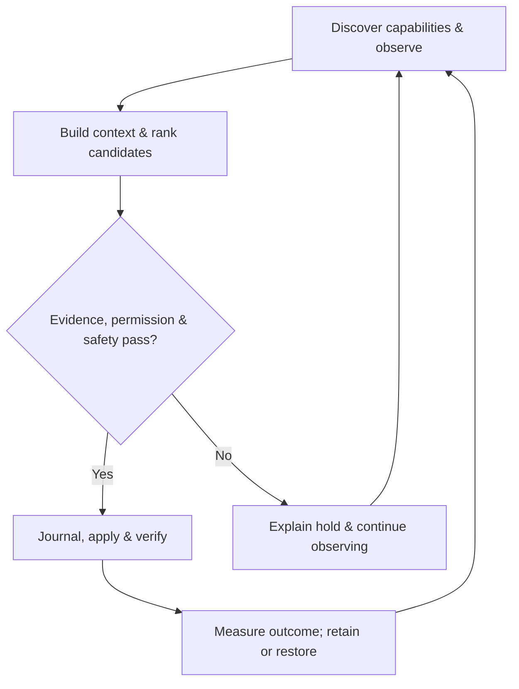

<p align="center">
  
</p>

<p align="center">
  <strong>On-device decisions. Measured outcomes. Recoverable changes.</strong><br>
  An autonomous C++20 engine for rooted Android, built around the capabilities your device actually exposes.
</p>

<p align="center">
  <a href="https://github.com/mystivara-creator/CoreFlow-Engine/releases"></a>
  <a href="https://github.com/mystivara-creator/CoreFlow-Engine/actions/workflows/build.yml"></a>
  
  
  <a href="LICENSE"></a>
</p>

<p align="center">
  <a href="https://github.com/mystivara-creator/CoreFlow-Engine/releases">Downloads</a> ·
  <a href="docs/TUNING.md">Settings guide</a> ·
  <a href="CHANGELOG.md">Changelog</a> ·
  <a href="https://github.com/mystivara-creator/CoreFlow-Engine/issues">Report a problem</a>
</p>

## Meet CoreFlow

CoreFlow System Framework runs a native daemon that observes workload, pressure,
thermal conditions and available rendering signals. It uses this evidence to rank
small tuning candidates, obtain permission for a specific target, and measure what
happens after a verified change. Useful outcomes inform later decisions; failed or
regressing trials follow the recovery and rollback paths.

The goal is responsive everyday use and steadier rendering within the device's
available headroom. Every device exposes different interfaces, so gains must be
measured on that device. The engine runs locally without a cloud account or API key.

## What it brings

| Capability | How CoreFlow uses it |
| --- | --- |
| **Runtime awareness** | CPU/load, memory, I/O, PSI, thermal and optional GPU/render telemetry inform the current context. Missing signals remain unavailable. |
| **Capability-based tuning** | CPU governor, memory, block queue, scheduler, GPU and cgroup candidates require supported interfaces, domain grants and safety admission. Discovery alone grants no write access. |
| **Trial memory** | Failed or unproven trials wait for relevant condition changes; accepted settings stay held while their context matches. Admission history survives restarts. |
| **Coordinated adaptation** | Condition-driven planning compares CPU and resource proposals together, joining justified targets in a bounded cohort. Fresh baselines, per-target verification and one shared outcome window evaluate the whole plan. |
| **Thermal stabilization** | ThermalGuard can apply load-reducing resource plans and keep verified cooling settings active, while withdrawing performance boosts. |
| **Durable recovery** | Mutation journals precede writes. Ownership checks prevent recovery from overwriting a detected external change. Failed handoffs keep tuning blocked. |
| **Memory across boots** | Lifetime sample IDs, retained candidate records and scoped experience persist on disk. Each boot still rebuilds a fresh measurement baseline. |
| **Offline WebUI** | Live runtime console, system/light/dark appearance, explained settings, journal filters, daemon logs and downloadable diagnostics. |

Thermal protection and fatal control surfaces remain excluded. Framework-owned
CPU frequency limits remain outside the generic write path. Rendering assistance
uses admitted kernel interfaces; app-level ADPF integration and Vulkan acceleration
are not capabilities this root daemon can universally provide.

## Requirements & installation

- Android **14 / API 34 or newer**, **ARM64** (`arm64-v8a`).
- Root and a module manager capable of installing the packaged module.
- OEM kernel interfaces and SELinux policy that permit the relevant operations.

| Environment | Integration scope |
| --- | --- |
| **KernelSU / compatible KernelSU managers** | Primary native WebUI path, using the manager's shell bridge. |
| **Magisk** | Module lifecycle scripts are provided; the native WebUI requires a compatible host and bridge. |
| **Other root managers / WebUI hosts** | Compatibility needs validation; package format alone does not establish support. |

1. Download a **packaged module ZIP** from [Releases](https://github.com/mystivara-creator/CoreFlow-Engine/releases). GitHub's source-code ZIP is not an installable binary module. Development artifacts are listed in [Actions](https://github.com/mystivara-creator/CoreFlow-Engine/actions/workflows/build.yml).
2. Install through your root manager and reboot.
3. Open the module WebUI. Check the daemon status and allow time for baseline collection before assessing tuning activity.
4. Review **Policy & Config** if you need to change cadence, confidence thresholds or permitted domains. Save the draft and restart the daemon to apply it.

The installed configuration enables bounded optimization automatically. Baseline
collection, cooldown and outcome observation are normal parts of the loop. Use
**Start / Stop / Restart** for lifecycle control. Safety holds, recovery failures and
operator stop markers remain authoritative after settings are saved.

## A readable control loop



For implementation details, see the [architecture](docs/ARCHITECTURE.md),
[source map](docs/SOURCE_MAP.md) and [capability guide](docs/CAPABILITY_DRIVEN.md).

## When something needs attention

Open **Journal & Logcat**, reload the diagnostic views and export the relevant
trace/logs. Include the installed version, device/ROM, root manager, reproduction
steps and the time the issue occurred in your [issue report](https://github.com/mystivara-creator/CoreFlow-Engine/issues).
Review exports for private app/process names before sharing them.

`RECOVERY_PENDING` means the daemon is reporting a blocked handoff or restore.
The heartbeat and last telemetry timestamp are separate: old sensor values do not
become fresh readings during recovery. `STALE` means status updates themselves
have stopped arriving; it does not identify the underlying cause by itself.

## Project resources

| Read this | For |
| --- | --- |
| [Coordinated & thermal plans](docs/COORDINATED_THERMAL_PLANS.md) | Live coupling, cooling behavior, cohort learning and recovery order |
| [Settings & tradeoffs](docs/TUNING.md) | Cadence, confidence, grants and bounded interactivity settings |
| [Checkpoint v3.1.2](docs/CHECKPOINT_3.1.2.md) | Persistence behaviour, release scope and device acceptance |
| [v3.2.0 source checkpoint candidate](docs/CHECKPOINT_3.2.0_SOURCE_CANDIDATE.md) | Contextual value admission, device provenance, ONNX inference evidence and release gates |
| [Build status](docs/BUILD_STATUS.md) | What local checks and CI can establish |
| [Device validation](docs/DEVICE_VALIDATION.md) | Testing behaviour, recovery and outcomes on a phone |
| [Native audit notes](docs/NATIVE_AUDIT_2026-11.md) | Confirmed findings, fixes and verification limits |
| [Safety boundaries](SECURITY.md) | Transaction, authority and recovery invariants |

## Build from source

```sh
npm ci --no-audit --no-fund
npm run build
cmake -S . -B /tmp/coreflow-build -DCORE_FLOW_BUILD_TESTS=ON -DCMAKE_BUILD_TYPE=Debug
cmake --build /tmp/coreflow-build --parallel
ctest --test-dir /tmp/coreflow-build --output-on-failure
bash tools/verify_safety_foundation.sh
bash tools/verify_source_release.sh
```

Keep build directories and SDK caches outside the source tree. The
[Android workflow](.github/workflows/build.yml) builds the native daemon,
module-local ONNX Runtime and offline WebUI into release artifacts. A passing
build is evidence for that commit; device testing establishes runtime behaviour.

## Maintainer & license

Created and maintained by [Mystivara](https://github.com/mystivara-creator).
CoreFlow is independently developed and distributed under the [MIT license](LICENSE).
