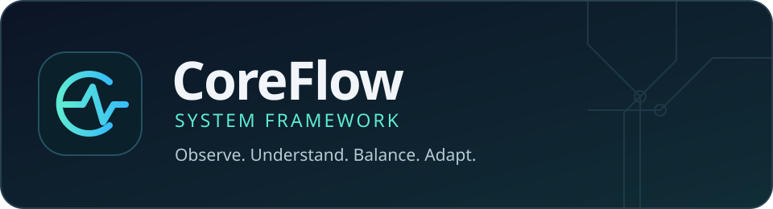

  

# CoreFlow Engine Modern v2.0

CoreFlow is a native C++23 + Rust 2024 stability-first Android optimizer. The target is not maximum benchmark output. The target is stable responsiveness across daily use, multitasking, and sustained workloads without a large overlapping decision architecture.

## Design rule: discover broadly, mutate narrowly

CoreFlow does not keep device-specific sysfs paths or model lists. At runtime it:

- enumerates mounted cgroup and cgroup2 filesystems from /proc/self/mountinfo;
- finds the semantic Android/Linux top-app group with cpu.uclamp.min and cpu.uclamp.max;
- verifies the pair is readable and writable;
- detects whether the kernel exposes percentage or 0..1024 capacity encoding;
- discovers trusted CPU/SoC thermal zones by type labels;
- reads standard Linux PSI from /proc/pressure/cpu, memory, and io.

Discovery never grants permission to mutate arbitrary nodes. Actuators include the verified top-app UClamp pair, CPUFreq/GPU devfreq ceilings discovered from exposed frequency tables, optional standard charging-current reduction and cgroup-v2 I/O weights. All go through the recovery journal.

## One small stability state machine

- Balanced: configured responsive baseline.
- Sustained Load: sustained CPU pressure with thermal headroom; moderately raises the top-app floor.
- Pressure Guard: memory or I/O contention is elevated; backs off artificial boosting while keeping the ceiling open.
- Thermal Guard: OEM thermal severity or a sensor-specific OEM passive trip requests mitigation; gently lowers the top-app ceiling.
- Emergency thermal exit: restores tracked values and stops CoreFlow so the OEM thermal stack has full control.

The Rust PID controller continuously adjusts a bounded capacity budget. CPU/GPU ceilings are quantized to kernel-exposed operating points. The engine never raises an OEM top-app maximum observed at startup. If another component changes an owned clamp, CoreFlow releases that value and stops; it can be restarted after the device policy settles.

There is no package-name game list, round-robin mutation, vendor display override, arbitrary cgroup migration, or background/foreground clamp rewriting.

## Safety

Every native write is preceded by a private fsync-backed write-ahead journal and followed by read-back verification. Clean stop restores tracked pre-CoreFlow values. An abrupt same-boot process death is recovered before the next daemon instance can mutate anything. The journal also records the intended value, so recovery leaves externally changed nodes under OEM control.

This is best-effort per-node recovery, not an atomic whole-device transaction.

## Runtime files

Config: /data/adb/coreflow/coreflow.conf  
Journal: /data/adb/coreflow/baseline.journal  
Daemon log: /data/adb/coreflow/logs/coreflowd.log  
Emergency disable: /data/adb/coreflow/DISABLE

Commands:

    su -c '/data/adb/modules/coreflow_engine/system/bin/coreflowd --status'
    su -c '/data/adb/modules/coreflow_engine/system/bin/coreflowd --capabilities'
    su -c '/data/adb/modules/coreflow_engine/system/bin/coreflowd --stop'
    su -c '/data/adb/modules/coreflow_engine/system/bin/coreflowd --rollback-baseline'

See [architecture](docs/ARCHITECTURE.md), [equilibrium blueprint](docs/EQUILIBRIUM_BLUEPRINT.md), [tuning](docs/TUNING.md), and [device validation](docs/DEVICE_TEST.md).

## Build and workbench

Requires CMake 3.22+, a C++23 compiler, Rust 1.85+ and Cargo. Android builds also
require the NDK and `rustup target add aarch64-linux-android`. Cargo dependencies
are pinned through `rust/Cargo.lock`; `cxx` provides the typed language bridge.

    cargo test --manifest-path rust/Cargo.toml --locked
    cmake -S . -B build/host -DCMAKE_BUILD_TYPE=Debug
    cmake --build build/host
    ctest --test-dir build/host --output-on-failure
    npm ci && npm run build

Architecture Studio includes a labeled thermal simulator, actual C++/Rust source
and Markdown/Text blueprint export. Native mode uses daemon data; browser
simulation is never device telemetry.

Power HAL service discovery is implemented. Transparent Binder interception,
generic NPU offload and measured frame-time collection are **not implemented**;
those require concrete platform/workload integration. No guaranteed FPS, energy
savings, zero overhead or component-longevity claim is made.

CI validates host tests, ASan/UBSan, WebUI build, shell syntax, and Android ARM64 packaging. Green CI is required before device testing, but is not proof of device compatibility.

License: MIT.

## Cross-device thermal correction

CPU/GPU temperatures are diagnostics, not battery/skin limits. Runtime control
uses Android thermal severity/headroom, falling back to read-only OEM trip
points for each sensor. Legacy universal Celsius cutoffs are ignored. Missing
thermal policy preserves the OEM baseline and is reported as unavailable.
Charging decisions use battery temperature only.
