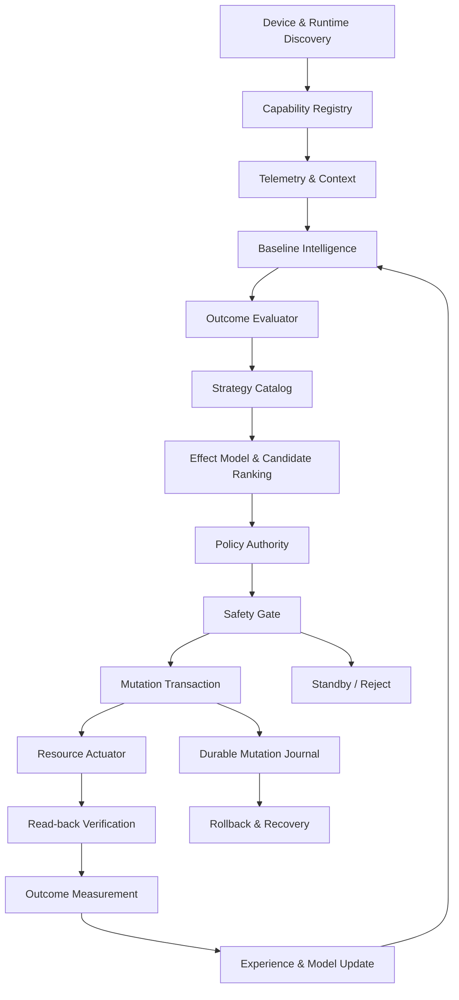

# CoreFlow Autonomous Engine

**Observe. Understand. Balance. Adapt.**

Capability-driven C++20 system optimization and fine-tuning engine for Android. Refines stock OEM/vendor kernel configurations dynamically across I/O, CPUFreq, UClamp, CpuSet, GPU/KGSL/Mali/GED rendering headroom, and VM pressure — cooperating with Android Power HAL and Performance Hint API without hardcoded tunable values.

| | |
|---|---|
| Version | `v3.0.1` (`versionCode` 3010) |
| Language | C++20 |
| ABI | `arm64-v8a` |
| Min API | 34 |
| Default mode | Standby (`mutation_mode=observe`, `mutation_armed=false`) |

---

## Closed-Loop Architecture



| Pillar | Role | Function |
|--------|------|----------|
| `src/observe/` | Discovery & Telemetry | Mount-derived procfs/cgroup/sysfs discovery, vendor PowerHAL/perf harvesting, dynamic 60–144Hz SurfaceFlinger frame telemetry, PSI & GPU busy sampling |
| `src/understand/` | Reasoning & Coupling | Context classification, `StrategyCatalog` cross-domain parameter coupling, `EffectModel` ranking, 18-feature ONNX thermal prediction, `BaselineIntelligence` |
| `src/balance/` | Policy & Safety Gate | `PolicyEngine`, `MutationAuthority` target-bound permits, `InteractivityBoostController`, `SAFE_MODE` / `DISABLE` / thermal guard holds |
| `src/mutation/` | Transaction & Actuators | `O_NOFOLLOW` + `fstat` kernel-FS verified writes, live read-back verification, single-epoch outcome attribution |
| `src/conscience/` | Durable Memory | Checksummed v2 `MutationJournal`, `RetainedStateStore`, `FatalSurface` guard, `DecisionTrace` |
| `src/runtime/` & `src/autonomous/` | Daemon Loop | Low-overhead `coreflowd` tick orchestration, config reload, status snapshot export |

---

## Key Capabilities (`v3.0.1`)

- **Zero hardcoded tunable values** — every candidate comes from kernel-advertised options (`scaling_available_governors`, `/queue/scheduler`, `available_frequencies`, KGSL `num_pwrlevels`, CPPC bounds), harvested vendor configs (`powerhint*.json`, `init*.rc`, perf XML/JSON), or bounded steps on catalogued interfaces.
- **Cross-domain StrategyCatalog coupling** — changing an I/O scheduler (`A -> B`), CPU governor, or workload regime (`DailyMultitasking`, `SustainedGaming`, `MemoryRelief`, `ThermalStabilization`) automatically re-ranks coupled block-queue (`nr_requests`, `read_ahead_kb`, `rq_affinity`, `wbt_lat_usec`), governor (`rate_limit_us`), foreground `uclamp.min`, and GPU floor candidates.
- **GPU & rendering headroom** — discovers Qualcomm Adreno KGSL (`min_pwrlevel`, `gpuclk`, `bus_split`, `force_bus_on`), Mali/arm-gpufreq/devfreq `min_freq`, and MediaTek GED surfaces; tracks live display refresh period (`60/90/120/144Hz`) to eliminate frame drops and micro-stutter while holding warm equilibrium (`48–52°C`) below thermal throttling.
- **Unattended multi-week safety** — starts in Standby by default; every Adaptive write commits a CRC32 v2 journal before opening the descriptor, verifies read-back, retains beneficial or verified zero-harm neutral improvements, and rolls back regressions or crash leftovers automatically.
- **Portrait-first KernelSU WebUI** — offline native WebUI (`module/webroot/`) with compact hamburger navigation for portrait phones, daemon lifecycle controls, live telemetry, and validated `config.ini` gating.

---

## Operating states

**Adaptive** is the autonomous tuning mode. It requires `mutation_mode=adaptive`,
`mutation_armed=true`, and explicit domain grants; capability discovery is not
permission to write. Policy, journal, verification, and rollback remain mandatory.

**Standby** disables new tuning writes while telemetry and reasoning continue.
Recovery may still restore changes owned by the engine, so this state is not
strictly read-only. The existing `mutation_mode=observe` token (also accepted as
`disabled` by the daemon) remains a compatibility setting. SAFE_MODE and DISABLE
still withdraw mutation authority. Baseline collection and outcome observation
are internal phases of Adaptive, not separate operating modes.

## Build & Verify

```sh
cmake -S . -B /tmp/coreflow-build -DCORE_FLOW_BUILD_TESTS=ON -DCMAKE_BUILD_TYPE=Debug
cmake --build /tmp/coreflow-build -j$(nproc)
ctest --test-dir /tmp/coreflow-build --output-on-failure
bash tools/verify_safety_foundation.sh
bash tools/verify_source_release.sh
```

Android ARM64 release ZIPs (`coreflowd` + `libonnxruntime.so` + WebUI) are built reproducibly by `.github/workflows/build.yml`. Keep build directories and SDK caches outside the source tree.

---

## Documentation

| Document | Scope |
|----------|-------|
| [`CHANGELOG.md`](CHANGELOG.md) | Release history (`v3.0.1` checkpoint) |
| [`SECURITY.md`](SECURITY.md) | Mutation safety invariants |
| [`docs/ARCHITECTURE.md`](docs/ARCHITECTURE.md) | Closed-loop pipeline & authority boundaries |
| [`docs/CAPABILITY_DRIVEN.md`](docs/CAPABILITY_DRIVEN.md) | Discovery, cross-domain coupling, and eligibility |
| [`docs/SOURCE_MAP.md`](docs/SOURCE_MAP.md) | Source tree layout |
| [`docs/TUNING.md`](docs/TUNING.md) | Operator configuration reference |
| [`docs/BUILD_STATUS.md`](docs/BUILD_STATUS.md) | CI & device validation scope |
| [`docs/DEVICE_VALIDATION.md`](docs/DEVICE_VALIDATION.md) | On-device verification checklist |
| [`docs/adr/`](docs/adr/) | Architecture Decision Records |

## License

See [`LICENSE`](LICENSE).
