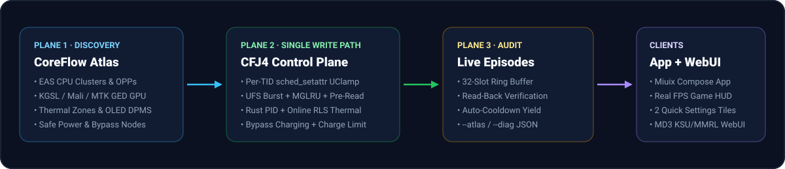

<p align="center">
  
</p>

<p align="center">
  <strong>Android 13+ (API 33+) · ARM64 · 100% Zero-Profile Autonomous C++23 + Rust Daemon · Hybrid CFW2/ONNX Neural Engine · Miuix Compose Companion App · Magisk / KernelSU / APatch</strong>
</p>

<p align="center">
  <a href="https://github.com/mystivara-creator/CoreFlow-Engine/releases"></a>
  <a href="https://github.com/mystivara-creator/CoreFlow-Engine/actions"></a>
  <a href="https://github.com/mystivara-creator/CoreFlow-Engine/actions/workflows/build-apk.yml"></a>
  <a href="LICENSE"></a>
  <a href="https://sociabuzz.com/hylentzzbroo"></a>
</p>

<p align="center">
  <a href="#end-to-end-architecture-upstream-to-downstream">Architecture</a> ·
  <a href="#4-hybrid-cfw2--onnx-neural-engine">Hybrid AI Engine</a> ·
  <a href="#coreflow-companion-app--md3-webui">Companion App</a> ·
  <a href="#offline--google-colab-training-pipeline">ML Training & Colab</a> ·
  <a href="#source-tree-map">Source Tree</a> ·
  <a href="#complete-documentation-hub">All Docs</a> ·
  <a href="#requirements--installation">Install</a> ·
  <a href="#support-the-project">Support</a>
</p>

---

## In Ten Seconds

**CFAE System Framework / CoreFlow Engine `v6.1.0-R`** is a **100% Zero-Profile Unified Autonomous** performance, thermal, and power orchestration framework for rooted Android — engineered in **C++23 + Rust** (compact native binary targeting `< 0.3%` idle CPU and `< 3 MB` RSS, verifiable via `coreflowd --diag` and `/proc/<pid>/status`) paired with a native **Miuix Compose Companion App** (with on-demand ARM64 ONNX Runtime) and bundled **MD3 WebUI**.

All semi-manual profile switches (`Balanced / Smoothness / Gaming / Battery`) and manual per-app override buckets are unified into **one real-time physics-driven autonomous loop** that adapts continuously per millisecond:
- **Zero-Lag Scrolling & Smoothness**: `< 5 ms` touchscreen boost + refresh-rate-adaptive `OverScroller` fling hold (`60Hz: 750ms`, `90Hz: 850ms`, `120Hz+: 950ms`) + automatic frame-drop jank rescue (`>= 3%` drops).
- **Automatic 3D Gaming**: Instant `HeavyGame3D` signature detection (`UnityMain`, `GameThread`, `VulkanThread`, `libUE4.so`, `libil2cpp.so`) + sustained GPU hysteresis + coupled CPU/GPU/Memory bus orchestration.
- **Multi-Cgroup EAS Thermal-Power Pacing & Low-Battery Auto-Eco**: OEM-contention-free Linux EAS `cpu.uclamp.max` ceilings across `top-app`, `foreground`, `system-background`, and `background` cut peak Big-core $C \cdot V^2 \cdot f$ voltage spikes and pin background tasks to Little cores whenever chassis temperature rises (`>= 38.5°C` or headroom `< 88%`), lifting immediately to `max` on `LaunchBurst` or `>= 3%` jank, plus automatic **Low-Battery Eco (`<= 20%` discharging, `500ms` fling hold while keeping scrolling smooth)**.
- **Minimal Escape Hatches Only**: 1-tap **Pause (A/B Compare)** and per-app **Exclude (Stock OEM)**.

Instead of dumping manual frequency sliders or fighting OEM thermal daemons, CoreFlow follows four strict engineering rules:

<p align="center">
  
</p>

---

## End-to-End Architecture (Upstream to Downstream)

<p align="center">
  
</p>

From silicon discovery up to real-time user diagnostics and offline model training, CoreFlow operates as a unified closed-loop pipeline:

### 1. Plane 1 — Hardware Discovery (`CoreFlow Atlas` · `--atlas`)
Single-pass hardware and kernel capability discovery at startup (zero hardcoded SoC lookup tables):
- **Compute & Memory**: EAS CPU clusters, OPP tables, governors, GPU (`KGSL`, `Mali`, `MediaTek GED`, `Xclipse`, `PowerVR`), memory bus `devfreq`, Linux `MGLRU`, `ZRAM`, `cgroup v2`, and `PSI` (CPU/Memory/I/O).
- **Storage & Display**: UFS/eMMC block queues, `dm-*` virtual devices, OLED DRM DPMS screen state, and live refresh rate (`VBlank` IRQ + display sensor).
- **Thermal & Power**: Multi-sensor thermal classification (`compute`, `skin`, `battery`, `board`), plus fail-closed discovery of safe writable charging control nodes (`input_suspend`, `charging_enabled`, `battery_charging_enabled`).

### 2. Boot-Calm Sanctuary & Passive OEM Co-op (`OemCollaborationMap`)
- **Post-Boot Thermal Tranquility**: On cold boot, `BootCalmSanctuary` waits for kernel/thermal quiescence before capturing true post-boot OEM baselines (after `perf-hal` and `mi_thermald` finish init), then ramps actuators smoothly over 30 seconds.
- **Zero Daemon Fighting**: Any sysfs node actively written by OEM thermal/perf daemons is detected via read-back verification and cooperatively yielded (`30s → 300s` backoff and persistent OEM collaboration map), preventing write-loops and battery drain.

### 3. Dual-Domain Thermal Physics, Multi-Cgroup EAS Pacing & Coupled Orchestrator
- **Self-Healing Android Thermal HAL**: Queries Android's native `AThermalManager` severity and `AThermal_getThermalHeadroom` with automatic 10-second retry/re-acquisition if `thermalservice` is unavailable at boot or restarts.
- **Dual-Domain Physics-Aware Fallback**: Whenever OEM thermal policy is unavailable, `evaluate_generic_thermal_fallback` separates **chassis/skin/battery** comfort limits (`40°C` recover / `44°C` trip) from **CPU silicon die** junction limits (`66°C` recover / `74°C` trip / `88°C` emergency), ensuring normal Snapdragon/Dimensity idle temperatures (`42–55°C`) never falsely trigger `THERMAL_GUARD`.
- **Rust Control Core (`rust/`) & Multi-Cgroup EAS Governor**: Zero-allocation OLS thermal velocity analyzer (`°C/min` fed by a $\tau = 15\text{ s}$ EWMA composite chassis+die filter), hysteretic PID controller, dual-timescale equilibrium planner, OEM-contention-free multi-cgroup EAS `cpu.uclamp.max` ceilings (`top-app`, `foreground`, `system-background`, `background`), automatic **Low-Battery Eco (`<= 20%`)**, and slew-rate limiter (`<= 0.08/s` down, `<= 0.06/s` up).

### 4. Hybrid CFW2 + ONNX Neural Engine
See full specification in [docs/architecture/CFW2_ONNX_NEURAL_ENGINE.md](docs/architecture/CFW2_ONNX_NEURAL_ENGINE.md).

| Tier | Engine | Footprint | Role |
|---|---|---|---|
| **Tier 1 (Optional Add-on)** | Dynamic ONNX Runtime C-API v1 (`dlopen` on trusted root-owned paths + `/data/adb/coreflow/models/equilibrium.onnx`) | **`0 B` in module ZIP** | Live ONNX execution with startup dry-run self-test and 3-strike circuit breaker |
| **Tier 2 (Primary Native)** | **`CFW2` Micro-MLP** (`/data/adb/coreflow/models/equilibrium.cfw2`) + Online RLS/NLMS | **`1,700 B` disk · `< 2 µs/tick`** | CRC32 & `O_NOFOLLOW` verified `10→16→12→3` FP32 network compiled from offline/Colab training |
| **Tier 3 (Built-in Fallback)** | Embedded physics-calibrated `10→16→12→3` RLS-MLP (+ legacy `CFW1`) | **Compiled in binary** | Always-available baseline adapting per device online |

- **Advisory-Only Contract**: Neural outputs (`aiPredicted10s`, `aiJankRisk`, `aiWorkloadClass`, `recommended_scale`) are strictly bounded advisory signals — they can never override OEM thermal ceilings, `CFJ4` allowlists, or hardware safety cutoffs (`58°C` battery / `95°C` SoC).

### 5. Plane 2 — Single Control Plane (`CFJ4 BaselineStore` & `Sovereign Tamper Guard`)
Every kernel and charging mutation flows through a single audited write-ahead journal (`CFJ4`):
- **Per-TID `SYS_sched_setattr` UClamp** driven by closed-loop `RenderLoadSampler` (`/proc/<pid>/task/<tid>/stat`) and `AppDnaStore` (`CFDNA2` zero-wear per-app learning).
- **Dynamic UFS/eMMC Launch Burst** (`200ms` foreground detection), background cgroup I/O QoS isolation, automatic Linux **MGLRU** tuning, and `posix_fadvise` library pre-read.
- **Sovereign Tamper Guard**: Read-only `0444` locking on leased root nodes with Reclaim-First enforcement and 3x/5s circuit breaker quarantine (`30s`) against conflicting root modules.
- **CFJ4-Protected Power Longevity**: Bypass Charging, Auto Bypass in Games, Battery Step-Charging, and Charge Ceiling (`80% / 85% / 90%` with 3% hysteresis) guarded by a hard lithium-ion **20% SOC floor / 25% resume hysteresis** (fail-closed if unsupported or unreadable).
- **Guaranteed Rollback & Boot-Loop Protection**: `--recover-only`, `--rollback-baseline`, and automatic `SAFE_MODE` on repeated early crashes (see [SECURITY.md](SECURITY.md)).

### 6. Plane 3 — Verified Telemetry & Live Decision Episodes (`--status` / `--episodes`)
Every mode shift, launch burst, thermal guard, OEM yield, tamper event, and config reload is recorded in a fixed-size zero-allocation ring buffer and exposed via JSON (`autonomousRegime`, `lowBatteryEco`, `appDnaEntries`) to both the Companion App and MD3 WebUI.

---

## CoreFlow Companion App & MD3 WebUI

Works directly on **Magisk, KernelSU, KernelSU-Next, and APatch** — **no KsuWebUI or MMRL required**!

- **Home**: Live telemetry pills (`SoC Temp`, `Render`, `UClamp`, `Headroom`), **SoC Temp & Headroom Sparkline**, 4-Pillar readiness strip, **Live Zero-Profile Autonomous Engine Card** (real-time regime badge + `EAS Cap · App DNA · Hybrid AI`), 1-tap **Pause (A/B Compare)**, and quick **Bypass Charging** toggle (when supported).
- **Control Hub (Capability-Driven)**: Per-cluster live EAS frequency bars, GPU busy % & live **Thermal Zones**, **Bypass Charging / Auto Bypass in Games / Charge Ceiling**, RAM/ZRAM & PSI stall monitors, Real FPS HUD controls, and **2 Quick Settings Tiles** (*CoreFlow Auto ↔ Paused OEM A/B* + *CoreFlow Bypass*).
- **Live AI Feed & `CFAE TELEMETRY LINK` Console**:
  - Live `DecisionEpisode` stream, 10-second AI thermal & jank-risk forecast, workload classifier, and backend status badge (`ONNX Live` / `CFW2 Micro-MLP` / `Embedded RLS`).
  - **On-Demand ARM64 ONNX Runtime (`0 MB` background RAM)**: Lazy-loaded off-main-thread when `LiveFeedTab` opens and deterministically closed on `Lifecycle.Event.ON_STOP` / `onDispose`.
    - `cfae_nlu_intent.onnx` (~34 KB, `256→32→12`): Free-form colloquial Indonesian & English NLU supporting honest Zero-Profile telemetry explanations plus natural-language `RESYNC`, `Pause (A/B Compare)`, and `Resume Autonomous` commands.
    - `cfae_session_anomaly.onnx` (~1.2 KB, `8→16→5`): 1-tap root-cause session anomaly analysis (`Healthy`, `Thermal Saturation`, `Fast-Charge Heat`, `Stutter / I/O Contention`, `External Tamper`).
- **App DNA & Stock OEM Exclusions**: Real app icons & names via `PackageManager`, live **App DNA** bias/efficiency badges, automatic `3D AUTO` game badges, and a single **Exclude (Stock OEM)** switch per app.
- **Floating Real FPS Game HUD**: Draggable overlay with real SurfaceFlinger FPS readout + live **Autonomous Regime** + **tap-to-expand Mini Panel** (1-tap Pause A/B + 1-tap Bypass Charging).
- **Settings, Neural Model Manager & Self-Audit**:
  - Instant **English / Bahasa Indonesia** switcher and Miuix/Monet themes.
  - **Neural Model Manager (SAF)**: Import/remove custom `1.7 KB` `.cfw2` models with client-side CRC32/bounds verification, anti-symlink root install, and graceful daemon reload.
  - **6-Check Device Health Self-Audit**, **Update Center**, **SAF Config Export/Import** (with SoC provenance check), native Share Sheet `--diag`, CFJ4 Journal inspector, and Emergency OEM Rollback.
- **Bundled MD3 WebUI**: Available as a zero-APK alternative inside KernelSU / APatch (or KsuWebUI / MMRL on Magisk) with 100% Zero-Profile Autonomous parity.

---

## Offline & Google Colab Training Pipeline

All Python training scripts in [`tools/`](tools/) run on **pure Python 3 (zero external dependencies)** — no GPU required, completing in `< 2 seconds` locally or inside **Google Colab**:

```bash
# Works directly on Linux/macOS/Windows or inside a Google Colab cell (prefix with `!`)
git clone https://github.com/mystivara-creator/CoreFlow-Engine.git
cd CoreFlow-Engine

# 1. Train a personalized 1,700 B CFW2 model from one or more exported `coreflow-diag-*.json` files
python3 tools/train_cfw2_from_diag.py \
  --diag coreflow-diag-1.json coreflow-diag-2.json \
  --epochs 120 --activation tanh \
  -o equilibrium.cfw2

# 2. Verify header, dimensions, weight bounds, and IEEE CRC32
python3 tools/onnx_to_cfw2.py --inspect equilibrium.cfw2

# 3. (Optional) Compile an external PyTorch/ONNX opset-13 10->16->12->3 MLP into CFW2
python3 tools/onnx_to_cfw2.py --from-onnx custom_model.onnx -o equilibrium.cfw2

# 4. (Optional) Verify or re-export Companion App ONNX NLU + Session Anomaly assets
python3 tools/train_companion_onnx.py --dry-run
```

Then import `equilibrium.cfw2` via **Companion App → Settings → Neural Model Manager** — `coreflowd` validates CRC32 & bounds and automatically switches `aiBackend` to `cfw2-micro-mlp`.

---

## Source Tree Map

```text
CoreFlow-Engine/
├── src/                  # C++23 daemon (coreflowd): daemon/, kernel/, v5/, v6/
├── include/coreflow/     # Public C++23 headers, config parser, thermal & neural contracts
├── rust/                 # Rust static core (PID, OLS thermal trend, equilibrium, UClamp, orchestrator)
├── android/              # Miuix Compose Companion App (Kotlin, libsu, on-demand ONNX Runtime, unit tests)
├── module/               # Magisk / KernelSU / APatch module scripts, service.sh, customize.sh, default.conf
├── webui/                # Bundled MD3 WebUI frontend (TypeScript + Vite)
├── tools/                # Pure-Python CFW2/ONNX trainers, compiler, Android NDK builder & CF-DVS validator
├── tests/                # 19 host C++/ASan/TSan tests, mock ORT C-API library, CLI & module lifecycle suites
├── config/               # Reference default configuration synced with module/system/etc/coreflow/default.conf
├── docs/                 # Full architecture, security, design, tuning, device validation & audit documentation
└── .github/workflows/    # CI/CD: Host C++, ASan+UBSan, TSan, ARM64 NDK ZIP, Companion APK & Release feed
```

---

## Complete Documentation Hub

Quick shortcuts to every technical document, specification, audit, and schema in this repository:

### Core Project & Governance
| Document | Description |
|---|---|
| [CHANGELOG.md](CHANGELOG.md) | Complete versioned release history and engineering milestones |
| [SECURITY.md](SECURITY.md) | Trust boundaries, root/SELinux model, CFJ4 recovery & safety guarantees |
| [LICENSE](LICENSE) | CoreFlow Community Source-Available License v1.0 |
| [NOTICE](NOTICE) | Third-party attribution and dependency notices |

### Engineering Blueprints & Guides
| Document | Description |
|---|---|
| [docs/ARCHITECTURE.md](docs/ARCHITECTURE.md) | High-level system architecture and subsystem interactions |
| [docs/ARCHITECTURE_UNIFIED.md](docs/ARCHITECTURE_UNIFIED.md) | v6.1.0-R unified runtime architecture: sense/understand/decide/act/guard/observe pipeline, physics, invariants, dump reading guide |
| [docs/architecture/CFW2_ONNX_NEURAL_ENGINE.md](docs/architecture/CFW2_ONNX_NEURAL_ENGINE.md) | Hybrid 3-tier `CFW2` + ONNX Runtime spec, binary layout, Phase A/B & Colab guide |
| [docs/DESIGN.md](docs/DESIGN.md) | Companion App & WebUI design language and Telemetry Honesty Contract |
| [docs/EQUILIBRIUM_BLUEPRINT.md](docs/EQUILIBRIUM_BLUEPRINT.md) | Thermal equilibrium, PID dynamics, and headroom control blueprint |
| [docs/TUNING.md](docs/TUNING.md) | Configuration keys, profiles, and safe operational thresholds |
| [docs/P2D6_GENERIC_PROVIDER_AND_HAL_OWNERSHIP.md](docs/P2D6_GENERIC_PROVIDER_AND_HAL_OWNERSHIP.md) | Generic thermal/hardware providers and HAL ownership rules |

### Architecture Contracts & Audits
| Document | Description |
|---|---|
| [docs/architecture/CDDP_P0_CONTRACT.md](docs/architecture/CDDP_P0_CONTRACT.md) | CoreFlow Deterministic Daemon Protocol (CDDP) P0 contract |
| [docs/architecture/CDDP_P0_P1_MILESTONE_SUMMARY.md](docs/architecture/CDDP_P0_P1_MILESTONE_SUMMARY.md) | CDDP P0/P1 implementation and verification summary |
| [docs/architecture/DIRECT_ADAPTIVE_RUNTIME.md](docs/architecture/DIRECT_ADAPTIVE_RUNTIME.md) | Direct adaptive runtime control-loop architecture |
| [docs/architecture/OWNERSHIP_CONTENTION_RETRY.md](docs/architecture/OWNERSHIP_CONTENTION_RETRY.md) | OEM contention detection, backoff, and ownership retry semantics |
| [docs/architecture/P1_FEATURE_ACCOUNTABILITY_REPORT.md](docs/architecture/P1_FEATURE_ACCOUNTABILITY_REPORT.md) | Feature accountability and telemetry honesty verification |
| [docs/architecture/P2A_DETERMINISTIC_LIFECYCLE.md](docs/architecture/P2A_DETERMINISTIC_LIFECYCLE.md) | Deterministic boot, reload, shutdown, and recovery lifecycle |
| [docs/architecture/P2B_PLATFORM_CONTEXT_AND_P2C_WORKLOAD_INTELLIGENCE.md](docs/architecture/P2B_PLATFORM_CONTEXT_AND_P2C_WORKLOAD_INTELLIGENCE.md) | Context engine, foreground tracking, and workload intelligence |
| [docs/architecture/P2D_TIERED_OPTIMIZATION_POLICY.md](docs/architecture/P2D_TIERED_OPTIMIZATION_POLICY.md) | Tiered optimization policy across thermal and workload regimes |
| [docs/audits/UNIFIED_MUTATION_OWNERSHIP_AUDIT.md](docs/audits/UNIFIED_MUTATION_OWNERSHIP_AUDIT.md) | Unified sysfs mutation ownership and rollback audit |

### Testing, Validation & CI/CD
| Document | Description |
|---|---|
| [docs/DEVICE_TEST.md](docs/DEVICE_TEST.md) | On-device verification checklist and A/B benchmarking guide |
| [docs/DEVICE_VALIDATION_SUITE.md](docs/DEVICE_VALIDATION_SUITE.md) | CoreFlow Device Validation Suite (`CF-DVS`) protocol and pass criteria |
| [docs/schemas/cf-dvs-report.schema.json](docs/schemas/cf-dvs-report.schema.json) | JSON Schema for `CF-DVS` validation bundles |
| [docs/CI_AND_GITHUB_SETTINGS.md](docs/CI_AND_GITHUB_SETTINGS.md) | GitHub Actions CI gates, sanitizer builds, and release signing setup |

---

## Requirements & Installation

- **Device**: Android 13+ (**API 33+**, ARM64 / `arm64-v8a`)
- **Root**: KernelSU, KernelSU-Next, APatch, or Magisk

### 1. Flash the Engine Module
1. Download **`CFAE-System-Framework-v6.0.0-R-arm64.zip`** from [GitHub Releases](https://github.com/mystivara-creator/CoreFlow-Engine/releases).
2. Flash in **KernelSU / KernelSU-Next / APatch / Magisk** (supports atomic hot-upgrade with read-only 4-pillar preflight checks and conflicting-module hard-block).
3. Reboot once on first install.

### 2. Install CoreFlow Companion App (Recommended)
1. Download **`CoreFlow-Companion-v6.0.0-R-release.apk`** from [GitHub Releases](https://github.com/mystivara-creator/CoreFlow-Engine/releases).
2. Install and grant root access when prompted by Magisk / KernelSU / APatch.
3. *(Alternative)* Open the bundled **MD3 WebUI** directly in KernelSU / APatch (or via **KsuWebUI** / **MMRL** on Magisk).

---

## Native CLI Reference

```sh
coreflowd --status            # Live JSON telemetry, thermal zones, clusters, episodes & history
coreflowd --atlas             # Full capability-driven hardware & kernel Atlas JSON
coreflowd --episodes          # Recent verified decision episodes
coreflowd --journal           # Inspect CFJ4 baseline rollback journal
coreflowd --diag              # One-shot privacy-safe diagnostic bundle (coreflow-diag-v6)
coreflowd --recover-only      # Replay pending same-boot CFJ4 journal without starting daemon
coreflowd --set-config key=v  # Atomic configuration update + live SIGHUP reload
coreflowd --rollback-baseline # Stop daemon & restore every modified kernel node to captured baseline
sh action.sh clear-safety     # Clear boot-loop SAFE_MODE/disable markers & reset boot_attempts
```

### Local Host Build & Verification
```sh
cmake -S . -B build-host -DCMAKE_BUILD_TYPE=Release
cmake --build build-host -j
ctest --test-dir build-host --output-on-failure
cargo clippy --manifest-path rust/Cargo.toml --all-targets -- -D warnings
```

---

## Support the Project

CoreFlow Engine & Companion App are built independently with heavy focus on real-hardware testing, kernel safety, and zero-bloat engineering. If CoreFlow helps your daily driver stay cooler, smoother, and longer-lasting, you can support ongoing development directly via **SociaBuzz**:

<p align="center">
  <a href="https://sociabuzz.com/hylentzzbroo">
    
  </a>
</p>

- Direct link: **https://sociabuzz.com/hylentzzbroo**

---

## Creator & AI Engineering Credits

- **Creator & Maintainer**: **[Mystivara Creator](https://github.com/mystivara-creator)** (`@mystivara-creator`)
- **Powered By · AI & Platform Partners**:
  - **Claude** (*Anthropic*) — Systems architecture & hardening
  - **ChatGPT** (*OpenAI*) — Prototyping & ideation
  - **Gemini** (*Google DeepMind*) — Native C++/Rust engine, Hybrid CFW2/ONNX AI & Miuix Compose engineering
  - **GitHub** — Actions CI/CD, ARM64 NDK builds & release hosting

---

## License

CoreFlow Engine & CoreFlow Companion are distributed under the **[CoreFlow Community Source-Available License v1.0](LICENSE)**:
- **Free & transparent**: You are welcome to download, use personally, inspect, audit, and learn from the entire codebase.
- **Respect authorship**: Please do not rebrand, resell, or redistribute modified forks/binaries as your own work without prior permission from `@mystivara-creator`.
