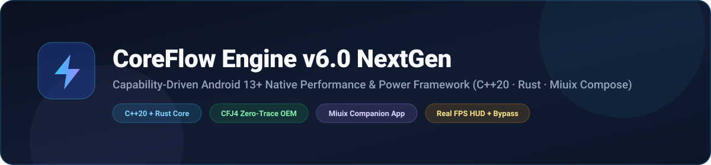
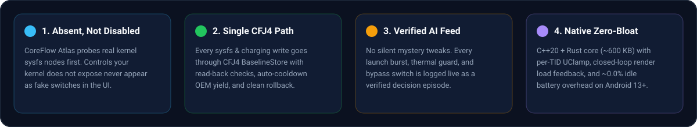

<p align="center">
  
</p>

<p align="center">
  <strong>Android 13+ (API 33+) · ARM64 · C++20 + Rust Daemon · Miuix Compose Companion App · Magisk / KernelSU / APatch</strong>
</p>

---

## In Ten Seconds

**CoreFlow Engine v6.0 NextGen** is an autonomous, capability-driven performance and power framework for rooted Android — engineered in **C++20 + Rust** (`~600 KB`, `~0.0%` idle battery overhead) paired with a native **Miuix Compose Companion App** and **MD3 WebUI**.

Instead of dumping fake switches or fighting OEM thermal daemons, CoreFlow v6 follows four strict engineering rules:

<p align="center">
  
</p>

---

## 3-Plane Architecture

<p align="center">
  
</p>

1. **Plane 1 — CoreFlow Atlas (`--atlas`)**: Single-pass hardware & kernel discovery across EAS CPU clusters/OPPs/governors, GPU (`KGSL`, `Mali`, `MediaTek GED`, `Xclipse`, `PowerVR`), UFS/eMMC queues, Linux `MGLRU` / `ZRAM` / `PSI`, OLED DRM DPMS, thermal zones, and safe writable charging control nodes.
2. **Plane 2 — Single CFJ4 Control Plane**: Every sysfs and charging mutation flows through `BaselineStore (CFJ4)` with read-back verification, exponential-backoff OEM coexistence (`30s → 300s`), and 100% zero-trace OEM rollback:
   - **Per-TID `SYS_sched_setattr` UClamp** driven by closed-loop `RenderLoadSampler` (`/proc/<pid>/task/<tid>/stat`).
   - **Dynamic UFS/eMMC Launch Burst** (`200ms` foreground detection) + background I/O QoS isolation.
   - **Automatic Linux MGLRU & Smart Pre-Read** (`posix_fadvise` library warmup).
   - **Rust PID + Online RLS/MLP Thermal Pacing** (10-second predictive headroom control).
   - **CFJ4-Protected Bypass Charging & Charge Ceiling %** (`input_suspend` / `charging_enabled` / `battery_charging_enabled` with 3% hysteresis — fail-closed if unsupported).
3. **Plane 3 — Live Verified Decision Episodes (`--episodes`)**: Every boot, mode shift, launch burst, thermal guard, OEM yield, and bypass toggle is logged into a zero-allocation 32-slot ring buffer so you always see *what changed, why, and whether read-back succeeded*.

---

## CoreFlow Companion App (Miuix Compose + `libsu`)

Works directly on **Magisk, KernelSU, KernelSU-Next, and APatch** — **no KsuWebUI or MMRL required**!

- **Home**: Aligned live telemetry pills (`SoC Temp`, `Render`, `UClamp`, `Headroom`), live **SoC Temp & Headroom Sparkline**, 4-Pillar readiness strip, 2x2 Autonomous Profiles (`Balanced`, `Smoothness`, `Gaming`, `Battery`), 1-tap **Pause (A/B Compare)**, and quick **Bypass Charging** toggle (when supported).
- **Control Hub (Capability-Driven)**: Live per-cluster EAS frequency bars, GPU busy % & live **Thermal Zones**, **Bypass Charging / Auto Bypass in Games / Charge Ceiling (80% / 85% / 90%)**, RAM/ZRAM & PSI stall monitors, Real FPS HUD controls, and **2 Quick Settings Tiles** (*CoreFlow Mode* + *CoreFlow Bypass*).
- **Live AI Feed**: Real-time stream of verified `DecisionEpisode` cards + 10-second AI thermal forecast.
- **Deep Per-App Rules**: Real app icons & names via `PackageManager`, automatic Game detection, Effective State badges (`Using Global` / `Override Active`), and 5-mode overrides (`Auto / Gaming / Smooth / Battery / Stock`).
- **Floating Real FPS Game HUD**: Draggable overlay over any game with real SurfaceFlinger FPS readout + **tap-to-expand Mini Game Panel** (4-profile pills, 1-tap Pause A/B, 1-tap Bypass Charging).
- **Settings, Backup & Bilingual UI**: Instant **English / Bahasa Indonesia** switcher, live Miuix/Monet themes, **SAF Profile Export/Import** with SoC provenance verification, native Share Sheet `--diag`, CFJ4 Journal inspector, and Emergency OEM Rollback.

---

## Requirements & Installation

- **Device**: Android 13+ (**API 33+**, ARM64 / `arm64-v8a`)
- **Root**: KernelSU, KernelSU-Next, APatch, or Magisk

### 1. Flash the Engine Module
1. Download **`CFAE-System-Framework-v6.0.0-arm64.zip`** from [GitHub Releases](https://github.com/mystivara-creator/CoreFlow-Engine/releases).
2. Flash in **KernelSU / KernelSU-Next / APatch / Magisk** (supports atomic hot-upgrade with read-only 4-pillar preflight checks).
3. Reboot once on first install.

### 2. Install CoreFlow Companion App (Recommended)
1. Download **`CoreFlow-Companion-v6.0.0-release.apk`** from [GitHub Releases](https://github.com/mystivara-creator/CoreFlow-Engine/releases).
2. Install and grant root access when prompted by Magisk / KernelSU / APatch.
3. *(Alternative)* Open the bundled **MD3 WebUI** directly in KernelSU / APatch (or via **KsuWebUI** / **MMRL** on Magisk).

---

## Native CLI Reference

```sh
coreflowd --status            # Live JSON telemetry, thermal zones, clusters, episodes & history
coreflowd --atlas             # Full capability-driven hardware & kernel Atlas JSON
coreflowd --episodes          # Recent verified decision episodes
coreflowd --journal           # Inspect CFJ4 OEM baseline rollback journal
coreflowd --diag              # One-shot privacy-safe diagnostic bundle (coreflow-diag-v6)
coreflowd --set-config key=v  # Atomic configuration update + live SIGHUP reload
coreflowd --rollback-baseline # Stop daemon & cleanly restore every modified OEM sysfs node
```

See [docs/DESIGN.md](docs/DESIGN.md) for the UI & Honesty Contract and [SECURITY.md](SECURITY.md) for the security model.

---

## Creator & AI Engineering Credits

- **Creator & Maintainer**: **[Mystivara Creator](https://github.com/mystivara-creator)** (`@mystivara-creator`)
- **Powered By · AI & Platform Partners**:
  - **Claude** (*Anthropic*) — Systems architecture & hardening
  - **ChatGPT** (*OpenAI*) — Prototyping & ideation
  - **Gemini** (*Google DeepMind*) — Native C++/Rust engine & Miuix Compose engineering
  - **GitHub** — Actions CI/CD, ARM64 NDK builds & release hosting

---

## License

CoreFlow Engine & CoreFlow Companion are distributed under the **[CoreFlow Community Source-Available License v1.0](LICENSE)**:
- **Free & transparent**: You are welcome to download, use personally, inspect, audit, and learn from the entire codebase.
- **Respect authorship**: Please do not rebrand, resell, or redistribute modified forks/binaries as your own work without prior permission from `@mystivara-creator`.
