# CoreFlow — Arsitektur & Konteks Tunggal (v6.1.0-R)

Dokumen ini satu-satunya "peta" cara CoreFlow berpikir dan bekerja. Isinya dibagi menjadi tiga bagian: **yang sudah ada** (diverifikasi dari kode dan dump perangkat), **prinsip desain**, dan **celah jujur** yang belum selesai.

> Dokumen acuan arsitektur runtime v6.1.0-R. Kontrak kejujuran dan desain UI ada di [DESIGN.md](DESIGN.md). Dokumen lama [ARCHITECTURE.md](ARCHITECTURE.md) menjelaskan kerangka CFAE v4.0.0 (mutation safety).

## 1. Satu kalimat

> CoreFlow adalah **pengendali umpan-balik tertutup**: ia mengukur kondisi fisik dan beban perangkat, memutuskan **berapa banyak daya yang boleh dipakai sekarang** (satu skalar `capacity_scale`), lalu menerjemahkannya ke batas-batas kernel yang aman, bisa di-rollback, dan tidak melawan OEM.

Tidak ada profil, mode manual, atau per-app preset. Perilaku muncul dari fisika dan telemetri.

## 2. Pipeline 6 lapis

```mermaid
flowchart TD
    subgraph S["1. SENSE (hanya membaca, zero-heap hot-path)"]
      HP["HardwareProbe<br/>topologi cluster, GPU, cgroup, node sysfs"]
      TM["ThermalMonitor<br/>zona die/board/baterai, komposit"]
      FP["FramePacingSensor<br/>Tier-A commit vs Tier-B probation<br/>(non-LTPO fixed-Hz fail-closed)"]
      SS["SchedstatSensor<br/>schedstat run_delay fg + SF"]
      VM["VmstatThrashingSensor<br/>/proc/vmstat refault + direct reclaim"]
      PSI["PSI cpu/io/mem + GPU busy"]
      CE["ContextEngine<br/>sentuhan, foreground, launch, game, media"]
      BP["BatteryPower<br/>arus, tegangan, mW, %"]
    end
    subgraph U["2. UNDERSTAND (estimasi)"]
      TT["ThermalTrend + ThermalModel (Rust)<br/>EWMA tau=15s, velocity, Adaptive-RLS RC<br/>(R_theta, tau, T_amb, P_budget)"]
      AI["Prediktor beban<br/>RLS / CFW2 / ONNX, jank risk"]
      DNA["AppDnaStore<br/>bias per-app yang dipelajari"]
      OR["Orchestrator (Rust)<br/>regime: GPU-bound, CPU-draw, IO-starved, hotspot"]
    end
    subgraph D["3. DECIDE (hukum kendali)"]
      CT["Controller + Equilibrium (Rust)<br/>PID + closed-loop P_budget (38..41.5 C)<br/>→ capacity_scale 0.25..1.0"]
    end
    subgraph A["4. ACT (aktuator)"]
      TS["ThreadScheduler<br/>per-TID uclamp min/max + starvation rescue"]
      TE["ThermalEnvelope<br/>governor CPU/GPU + EAS cgroup uclamp.max"]
      SM["StorageMemory<br/>readahead, 2-regime MGLRU/swap, bg isolation"]
      SK["SemanticKnobs + Longevity<br/>knob sched/vm, batas charge"]
    end
    subgraph G["5. GUARD (keselamatan & koeksistensi)"]
      MC["MutationCoordinator<br/>satu jalur tulis"]
      BS["BaselineStore CFJ4<br/>nilai pabrik + rollback"]
      OEM["OEM Collaboration Map<br/>yield saat OEM menulis node yang sama"]
      HS["Hard cutoff + Tamper Guard + Boot Calm"]
    end
    subgraph O["6. OBSERVE"]
      DJ["DecisionJournal (episodes)"]
      ST["status JSON / diag / audit"]
      UI["Companion App + WebUI"]
    end
    S --> U --> D --> A --> G
    G -->|"tulis terverifikasi (readback)"| KERNEL[("Kernel: sysfs / procfs / cgroup")]
    KERNEL -.->|"umpan balik: suhu, fps, schedstat, vmstat"| S
    G --> O
```



Lokasi kode:

| Lapis | File utama |
|---|---|
| Sense | `src/v5/hardware_probe.cpp`, `src/kernel/thermal_monitor.cpp`, `src/v6/frame_pacing_sensor.cpp`, `src/v6/schedstat_sensor.cpp`, `src/v6/vmstat_thrashing_sensor.cpp`, `src/v5/context_engine.cpp` |
| Understand | `rust/src/thermal_trend.rs`, `rust/src/thermal_model.rs`, `src/kernel/neural_predictor.cpp`, `src/v6/app_dna_store.cpp`, `rust/src/orchestrator.rs` |
| Decide | `rust/src/controller.rs`, `rust/src/thermal_trend.rs` (`compute_thermal_equilibrium`), `rust/src/uclamp.rs` |
| Act | `src/v5/thread_scheduler.cpp`, `src/v5/thermal_envelope_actuator.cpp`, `src/v5/storage_memory_actuator.cpp`, `src/v6/semantic_knob_engine.cpp` |
| Guard | `src/kernel/mutation_coordinator.cpp`, `src/kernel/baseline_store.cpp`, `src/v6/oem_collaboration_map.cpp`, `src/v6/boot_calm_sanctuary.cpp` |
| Loop | `src/daemon/main.cpp` (reactor + timerfd), `src/daemon/reactor.cpp` |

## 3. Fisika di balik keputusan

1. **Daya dinamis:** \(P \approx C\,V^2 f\). Tegangan naik hampir linear dengan frekuensi di ujung atas OPP, jadi 10% frekuensi terakhir bisa memakan ±25–30% daya tetapi memberi <10% kinerja. Memangkas **lutut atas** itu hampir gratis untuk pengguna dan mengurangi panas secara nyata. Ini alasan `uclamp.max` memotong ceiling dan tidak membekukan frekuensi minimum.
2. **Termal itu RC:** \(T_{chassis} \approx T_{amb} + P_{sustained}\cdot R_\theta\), dengan konstanta waktu menit, bukan detik. Konsekuensinya:
   - Die melonjak cepat (detik), baterai/casing lambat (menit).
   - Keputusan termal harus memakai sinyal lambat (EWMA τ=15 s), bukan suhu die mentah.
   - **Anggaran daya receding-horizon tertutup (`P_budget`)**: Ketika `ThermalModelEstimator` telah konvergen (`confidence >= 45`, saat discharging), CoreFlow menghitung target adaptif \(T_{\text{target,eff}} = \text{clamp}(\max(38.0,\ T_a + 7.0),\ 38.0,\ 41.5^\circ\text{C})\) dan anggaran daya fisik:
     $$P_{\text{budget}}(t) = \frac{T_{\text{target,eff}} - T_a}{R_\theta} + \frac{\tau \cdot (T_{\text{target,eff}} - T_{\text{chassis}})}{R_\theta \cdot H}$$
     lalu memetakannya ke `capacity_scale` via hukum daya silikon \(P \propto s^{1.8}\). Dengan *adaptive forgetting* + *soft covariance injection* di `thermal_model.rs`, estimator otomatis beradaptasi ketika pengguna berpindah suhu ruangan (AC vs luar ruangan tropis) atau memasang *external Peltier cooler*.
3. **Responsif = latensi antrean & deadline, bukan frekuensi puncak:** Yang menentukan rasa mulus adalah seberapa cepat thread kritis (UI/Render/SurfaceFlinger) mendapat CPU tanpa menunggu di runqueue. `SchedstatSensor` mengukur `run_delay_ns` aktual dari `/proc/<pid>/task/<tid>/schedstat` (universal di semua nama thread/engine tanpa eBPF) untuk memicu penyelamatan `uclamp.min` per-TID dan isolasi background secara langsung — bahkan ketika panel fixed-Hz non-LTPO tidak menyediakan sensor FPS commit.
4. **Memori anti-freeze dua-regime (`/proc/vmstat`):** `VmstatThrashingSensor` membedakan **eviksi page-cache awal** (`workingset_refault_file` tinggi saat RAM masih tersedia → naikkan pelindung MGLRU `min_ttl_ms` hingga 1200 ms + dorong halaman anonim dingin ke ZRAM) vs **badai direct-reclaim** (`pgsteal_direct >= 64/s` → langsung nolkan `min_ttl_ms`, hentikan `read_ahead_kb` burst & prefetch agar alokasi UI tidak membeku).
5. **Little's Law (\(L=\lambda W\))** dipakai Orchestrator (menggabungkan `render_pressure`, CPU PSI, dan `starvation_pressure`) untuk menentukan siapa bottleneck (CPU, GPU, atau memori/IO) sehingga daya diberikan ke yang membuat pipeline macet, bukan ke semuanya.

## 4. Variabel kendali tunggal

```
sinyal beban + tekanan termal + P_budget RC ──► Controller + Equilibrium ──► capacity_scale ∈ [0.25, 1.0]
```

`capacity_scale` adalah satu-satunya angka "berapa daya yang boleh". Semua aktuator **menerjemahkan** skalar itu sesuai sifat fisiknya sendiri:

| Aktuator | Terjemahan dari `capacity_scale` |
|---|---|
| ThermalEnvelope | ceiling frekuensi CPU/GPU, `hispeed_load`; `top-app` / `foreground` / `system-background` `cpu.uclamp.max` |
| StorageMemory | `background/cpu.uclamp.max` ke kapasitas core Little saat hangat/starvation; readahead, 2-regime MGLRU & swappiness berbasis `/proc/vmstat` |
| ThreadScheduler | uclamp min/max per-TID (dibatasi skalar, dengan penyelamatan jank & `schedstat` runqueue starvation) |
| Knob semantik | agresivitas sched/vm |

Aturan prioritas (urutan menang bila konflik):

1. **Keselamatan keras:** baterai ≥ 58 °C atau die ≥ 95 °C → semuanya rollback ke baseline.
2. **Latensi pengguna:** `LaunchBurst`, jank terverifikasi ≥ 3%, `schedstat` starvation ≥ 0.20, atau suhu dingin → cap/floor `top-app` dan thread kritis langsung diangkat (kecuali `THERMAL_GUARD` aktif).
3. **Termal:** saat hangat atau melampaui `P_budget` → cap daya sesuai skalar (`THERMAL_GUARD` tetap mengunci penuh pada chassis ≥ 44 °C / die ≥ 76 °C).
4. **Baterai:** Low-Battery Eco (≤ 20%) memangkas sedikit tanpa merusak scroll.
5. **Efisiensi idle:** mode `Efficiency` / `ScreenOff` melepas boost, mempertahankan cap EAS hangat, dan menidurkan seluruh sensor (0 syscall).

## 5. Konteks (pengganti "profil")

`ContextEngine` hanya **mengklasifikasi situasi**, tidak memilih preset: `ScreenOff`, `Efficiency`, `Interactive`, `LaunchBurst`, `Gaming` (+ flag kamera/media). Kesimpulannya:

- "Profil" lama (smooth, balanced, gaming, battery, per-app) sudah dilebur. Yang tersisa adalah **konteks terukur + skalar fisik**.
- Kepribadian per-app datang dari **App DNA** (bias terpelajar), bukan dari pengaturan manual.
- Perpindahan konteks berbasis sentuhan (tahan 750 ms di 60 Hz) memang cepat berganti. Itu disengaja agar responsif.

## 6. Invarian yang tidak boleh dilanggar

1. **Satu jalur tulis.** Semua penulisan node lewat `MutationCoordinator` → `BaselineStore` (CFJ4) dengan readback. Tidak ada tulis liar.
2. **Selalu bisa kembali.** Nilai pabrik disimpan sebelum tulis pertama; "release-on-calm" mengembalikan saat tenang.
3. **Satu pemilik per node.** Dua aktuator tidak boleh menulis node yang sama. Di v6.1.0-R, node cap `top-app`, `foreground`, `system-background`, `background` dipaksa berbeda (lihat commit `62cf513`).
4. **Yield ke OEM.** Jika OEM menulis balik node yang sama, CoreFlow mundur dan mencatatnya (`oemYieldedPaths`), dan tidak berperang.
5. **Penemuan dinamis.** Tidak ada path vendor yang di-hardcode; path ditemukan dari mountinfo/sysfs. Satu-satunya konvensi tetap adalah nama grup AOSP kanonik (`top-app`, `foreground`, `background`).
6. **Jujur tentang yang tidak diketahui (Fail-Closed Sensor Contract).** Fitur yang tidak ada di perangkat itu *absen*, tidak ditampilkan sebagai nonaktif. Sumber frame Tier-B (`vblank_irq`, `*/fps` generik) tidak pernah mengeluarkan `jank_ratio = 0.0` sebelum lolos verifikasi idle-drop; panel fixed-Hz non-LTPO yang terkunci ≥ 92% `target_hz` selama 3 probe idle berturut-turut dikarantina fail-closed (`fail_closed:fixed_hz_panel`) untuk sesi boot tersebut.

## 7. Cara membaca perilaku di perangkat

| Pertanyaan | Lihat di dump |
|---|---|
| Apakah CoreFlow sedang menekan? | `capacityScale` < 0,90, `autonomousRegime`, `easCappedGroups`, `easTopAppCapPct` |
| Apa yang sebenarnya ditulis? | `journal.entries` (path, nilai pabrik, nilai aktif) |
| Apakah OEM melawan? | `oemYieldedPaths`, `contendedPaths` |
| Seberapa cepat memanas? | `thermalVelocityCpm` (sudah di-EWMA) |
| Apakah closed-loop RC aktif & berapa anggaran dayanya? | `thermalModel` (`valid`, `closedLoopActive`, `effectiveTargetCelsius`, `powerBudgetMw`, `rThetaCPerW`, `tauSec`, `ambientCelsius`, `sustainablePowerMw`, `confidence`) |
| Apakah sensor FPS terverifikasi atau panel fixed-Hz fail-closed? | `hyperFluid` (`framePacingAvailable`, `framePacingVerified`, `framePacingSource`, `measuredFps`, `jankRatio`) |
| Apakah ada CPU runqueue starvation atau RAM thrashing? | `hyperFluid` (`schedstatSupported`, `runqueueDelayMs`, `starvationPressure`, `vmstatSupported`, `refaultFilePerSec`, `directReclaimPerSec`, `thrashingPressure`, `directReclaimStorm`) |
| Mengapa mode berganti? | `episodes` (`ModeShift`, `LaunchBurst`, `ThermalRecovered`, `FramePacingFailClosed`) |
| Apakah ada gangguan? | Self-Audit 6 cek, AVC denials |

## 8. Celah jujur (belum selesai / belum terbukti)

1. **Validasi lapangan 30 menit pasca-boot pada perangkat fisik.** Seluruh 6 arketipe lintas-OEM kini terverifikasi deterministik di CI oleh **Virtual SoC Farm (`CF-Sim`)** (`tests/cf_sim_plant.hpp` + `tests/cf_sim_farm.cpp` menjalankan binary `coreflowd_sim` sungguhan dengan jam virtual dipercepat), namun validasi lapangan 20–30 menit pada perangkat fisik tetap dianjurkan untuk mengonfirmasi kurva `R_theta`/`tau`/`ambientCelsius` di dunia nyata.
2. **Belum ada verifikasi kausal daring (`device_effectiveness.map`).** `CF-Sim` membuktikan 0 osilasi, 0 perang tulis OEM, 0 false `THERMAL_GUARD`, karantina non-LTPO fail-closed, dan rollback `CFJ4` bersih lintas 6 arketipe SoC/OEM di CI; pengukuran efektivitas kausal *on-device* per aktuator menjadi langkah lanjutan berikutnya.
3. **Belum ada distribusi frame-time per-frame (`p95`/`p99`).** `FramePacingSensor` kini fail-closed aman di panel non-LTPO dan dibantu `SchedstatSensor` `run_delay`, namun belum mengukur distribusi *per-commit frame time* `p99` terhadap batas VSync secara langsung.

## 9. Arah penyempurnaan (urutan usulan)

1. **Validasi lapangan Fase 1 + Fase 2**: Ambil dump 30 menit pada perangkat fisik sekaligus jaga scorecard 6 arketipe `CF-Sim` (`cf-sim-report.json`) hijau di setiap PR (Host, ASan+UBSan, TSan).
2. **Fase 2B — Online Causal Verification (`device_effectiveness.map`)**: Ukur efektivitas aktual (penurunan Watt / suhu / starvation) tiap aktuator secara daring dan nonaktifkan otomatis aktuator tanpa dampak di SoC tertentu.
3. **Fase 3 — Per-Frame `p99` Deadline Control & Online Silicon EDP Knee**: Jadikan margin deadline VSync (`p99`) sebagai fungsi tujuan resmi bersama profil kurva efisiensi $C \cdot V^2 \cdot f$ per-perangkat.


