# CoreFlow — Arsitektur & Konteks Tunggal (v6.1.0-R)

Dokumen ini satu-satunya "peta" cara CoreFlow berpikir dan bekerja. Isinya dibagi menjadi tiga bagian: **yang sudah ada** (diverifikasi dari kode dan dump perangkat), **prinsip desain**, dan **celah jujur** yang belum selesai.

> Dokumen acuan arsitektur runtime v6.1.0-R. Kontrak kejujuran dan desain UI ada di [DESIGN.md](DESIGN.md). Dokumen lama [ARCHITECTURE.md](ARCHITECTURE.md) menjelaskan kerangka CFAE v4.0.0 (mutation safety).

## 1. Satu kalimat

> CoreFlow adalah **pengendali umpan-balik tertutup**: ia mengukur kondisi fisik dan beban perangkat, memutuskan **berapa banyak daya yang boleh dipakai sekarang** (satu skalar `capacity_scale`), lalu menerjemahkannya ke batas-batas kernel yang aman, bisa di-rollback, dan tidak melawan OEM.

Tidak ada profil, mode manual, atau per-app preset. Perilaku muncul dari fisika dan telemetri.

## 2. Pipeline 6 lapis

```mermaid
flowchart TD
    subgraph S["1. SENSE (hanya membaca, zero-heap hot-path)"]
      HP["HardwareProbe<br/>topologi cluster, GPU, cgroup, node sysfs"]
      TM["ThermalMonitor<br/>zona die/board/baterai, komposit"]
      FP["FramePacingSensor<br/>Tier-A commit vs Tier-B probation<br/>(non-LTPO fixed-Hz fail-closed)"]
      SS["SchedstatSensor<br/>schedstat run_delay fg + SF"]
      VM["VmstatThrashingSensor<br/>/proc/vmstat refault + direct reclaim"]
      PSI["PSI cpu/io/mem + GPU busy"]
      CE["ContextEngine<br/>sentuhan, foreground, launch, game, media"]
      BP["BatteryPower<br/>arus, tegangan, mW, %"]
    end
    subgraph U["2. UNDERSTAND (estimasi)"]
      TT["ThermalTrend + ThermalModel (Rust)<br/>EWMA tau=15s, velocity, Adaptive-RLS RC<br/>(R_theta, tau, T_amb, P_budget)"]
      AI["Prediktor beban<br/>RLS / CFW2 / ONNX, jank risk"]
      DNA["AppDnaStore<br/>bias per-app yang dipelajari"]
      OR["Orchestrator (Rust)<br/>regime: GPU-bound, CPU-draw, IO-starved, hotspot"]
    end
    subgraph D["3. DECIDE (hukum kendali)"]
      CT["Controller + Equilibrium (Rust)<br/>PID + closed-loop P_budget (38..41.5 C)<br/>→ capacity_scale 0.25..1.0"]
    end
    subgraph A["4. ACT (aktuator)"]
      TS["ThreadScheduler<br/>per-TID uclamp min/max + starvation rescue"]
      TE["ThermalEnvelope<br/>governor CPU/GPU + EAS cgroup uclamp.max"]
      SM["StorageMemory<br/>readahead, 2-regime MGLRU/swap, bg isolation"]
      SK["SemanticKnobs + Longevity<br/>knob sched/vm, batas charge"]
    end
    subgraph G["5. GUARD (keselamatan & koeksistensi)"]
      MC["MutationCoordinator<br/>satu jalur tulis"]
      BS["BaselineStore CFJ4<br/>nilai pabrik + rollback"]
      OEM["OEM Collaboration Map<br/>yield saat OEM menulis node yang sama"]
      HS["Hard cutoff + Tamper Guard + Boot Calm"]
    end
    subgraph O["6. OBSERVE"]
      DJ["DecisionJournal (episodes)"]
      ST["status JSON / diag / audit"]
      UI["Companion App + WebUI"]
    end
    S --> U --> D --> A --> G
    G -->|"tulis terverifikasi (readback)"| KERNEL[("Kernel: sysfs / procfs / cgroup")]
    KERNEL -.->|"umpan balik: suhu, fps, schedstat, vmstat"| S
    G --> O
```



Lokasi kode:

| Lapis | File utama |
|---|---|
| Sense | `src/v5/hardware_probe.cpp`, `src/kernel/thermal_monitor.cpp`, `include/coreflow/v6/chassis_temp_fuser.hpp`, `src/v6/frame_pacing_sensor.cpp`, `src/v6/schedstat_sensor.cpp`, `src/v6/vmstat_thrashing_sensor.cpp`, `src/v5/context_engine.cpp` |
| Understand | `rust/src/thermal_trend.rs`, `rust/src/thermal_model.rs`, `src/kernel/neural_predictor.cpp`, `src/v6/app_dna_store.cpp`, `src/v6/causal_verifier.cpp`, `rust/src/orchestrator.rs` |
| Decide | `rust/src/controller.rs`, `rust/src/thermal_trend.rs` (`compute_thermal_equilibrium`), `rust/src/uclamp.rs` |
| Act | `src/v5/thread_scheduler.cpp`, `src/v5/thermal_envelope_actuator.cpp`, `src/v5/storage_memory_actuator.cpp`, `src/v6/semantic_knob_engine.cpp` |
| Guard | `src/kernel/mutation_coordinator.cpp`, `src/kernel/baseline_store.cpp`, `src/v6/oem_collaboration_map.cpp`, `src/v6/boot_calm_sanctuary.cpp`, `src/v6/causal_verifier.cpp` |
| Loop | `src/daemon/main.cpp` (reactor + timerfd), `src/daemon/reactor.cpp` |

## 3. Fisika di balik keputusan

1. **Daya dinamis & Online Silicon EDP Knee (`EdpKneeCalibrator`, `silicon_edp.map` / `CFEDP2`):** \(P \approx P_{\text{base}} + k \cdot s^{\hat{\alpha}}\). Tegangan naik hampir linear dengan frekuensi di ujung atas OPP, sehingga 10% frekuensi terakhir bisa memakan ±25–30% daya dengan gain <10%. `EdpKneeCalibrator` mengkalibrasi eksponen silikon aktual \(\hat{\alpha} \in [1.35, 2.80]\) dan titik lutut EDP (`edp_knee_scale` \(\in [0.55, 0.88]\), ambang kemiringan marjinal daya/performa \(> 1.65\)) secara daring dari telemetri daya & frekuensi aktual (8-bin zero-heap, tanpa tabel hardcode per-SoC, fail-closed pada kurva datar/non-monoton/noisy). Aktivasi memakai *C0 smooth blend* pada `confidence 50..70` yang tersinkronisasi antara rekonstruksi `P_demand`, `thermal_trend.rs`, dan `uclamp.max`, dengan persistensi Zero-Wear `CFEDP2` (`fsync` + `renameat` + `fsync` direktori induk, auto-reset saat OTA kernel/ROM).
2. **Termal itu RC:** \(T_{chassis} \approx T_{amb} + P_{sustained}\cdot R_\theta\), dengan konstanta waktu menit, bukan detik. Konsekuensinya:
   - Die melonjak cepat (detik), baterai/casing lambat (menit).
   - Keputusan termal harus memakai sinyal lambat (EWMA τ=15 s), bukan suhu die mentah.
   - **Tahan kuantisasi 1°C bulat & bebas "Success Penalty"**: Pada fuel-gauge yang melompat 1°C bulat (mis. `thermal_zone52` baterai), `ChassisTempFuser` memadukan jangkar DC baterai fisik dengan detail AC terbatas (±0,65°C) dari sensor board/skin miliderajat (`skin` / `xo-therm` / `ap_therm`) dengan **nol bias DC** (sementara batas keselamatan keras ≥ 44°C / ≥ 58°C tetap membaca baterai fisik mentah). Di lapisan Rust (`thermal_model.rs`), filter transisi LTI bebas-bias + detektor kuantisasi `q_step_est` + memori eksitasi *information-bank* memastikan `confidence` tetap menembus gate `>= 45` dan mengaktifkan `closedLoopActive` meski suhu gaming telah tertahan datar di 41°C — bahkan pada perangkat minimal tanpa sensor `xo-therm`.
   - **Anggaran daya receding-horizon tertutup (`P_budget`)**: Ketika `ThermalModelEstimator` telah konvergen (`confidence >= 45`, saat discharging), CoreFlow menghitung target adaptif \(T_{\text{target,eff}} = \text{clamp}(\max(38.0,\ T_a + 7.0),\ 38.0,\ 41.5^\circ\text{C})\) dan anggaran daya fisik:
     $$P_{\text{budget}}(t) = \frac{T_{\text{target,eff}} - T_a}{R_\theta} + \frac{\tau \cdot (T_{\text{target,eff}} - T_{\text{chassis}})}{R_\theta \cdot H}$$
     lalu memetakannya ke `capacity_scale` via hukum daya silikon terkalibrasi \(P \propto s^{\hat{\alpha}}\) (default `1.8`, *C0-blended* ke \(\hat{\alpha}\) hasil `EdpKneeCalibrator` pada `confidence 50..70`). Dengan *adaptive forgetting* + *soft covariance injection* di `thermal_model.rs`, estimator otomatis beradaptasi ketika pengguna berpindah suhu ruangan (AC vs luar ruangan tropis) atau memasang *external Peltier cooler*.
3. **Responsif = latensi antrean & margin deadline `p99`, bukan frekuensi puncak:** Yang menentukan rasa mulus adalah seberapa konsisten ekor distribusi frame (`p99`) selesai di dalam anggaran VSync \(T_{\text{budget}} = 1000/\text{Hz}\) tanpa menunggu di runqueue. `SchedstatSensor` mengukur `run_delay_ns` aktual dari `/proc/<pid>/task/<tid>/schedstat` (universal tanpa eBPF), dan `FramePacingSensor` menjalankan ring-buffer 64-entri zero-heap untuk menghitung `p99FrameTimeMs` dan `p99DeadlineUtil` dari sumber commit terverifikasi (`Tier A` / `ProvenCommit`) — **strict fail-closed** pada panel non-LTPO fixed-Hz dan imun terhadap layar statis / LTPO idle (`< 12 FPS` atau `screen_idle_hint`). Di `uclamp.rs`, `p99DeadlineUtil <= 0.80` memangkas `uclamp.min` halus hingga `-12%` (dibekukan saat `feedforward_freeze` / `starvation_rescue`), `0.80..0.92` netral, dan `>= 0.92` menyuntikkan rescue proporsional hingga `+22%` sekaligus melepaskan plafon EDP knee bila deadline terancam.
4. **Memori anti-freeze dua-regime (`/proc/vmstat`):** `VmstatThrashingSensor` membedakan **eviksi page-cache awal** (`workingset_refault_file` tinggi saat RAM masih tersedia → naikkan pelindung MGLRU `min_ttl_ms` hingga 1200 ms + dorong halaman anonim dingin ke ZRAM) vs **badai direct-reclaim** (`pgsteal_direct >= 64/s` → langsung nolkan `min_ttl_ms`, hentikan `read_ahead_kb` burst & prefetch agar alokasi UI tidak membeku).
5. **Little's Law (\(L=\lambda W\))** dipakai Orchestrator (menggabungkan `render_pressure`, CPU PSI, dan `starvation_pressure`) untuk menentukan siapa bottleneck (CPU, GPU, atau memori/IO) sehingga daya diberikan ke yang membuat pipeline macet, bukan ke semuanya.
6. **Verifikasi Kausal Daring (`CausalVerifier`, `device_effectiveness.map` / `CFEM2`):** Mengamati manfaat sistem nyata pada 6 domain aktuator (`thermal_uclamp_cap`, `thermal_gpu_cap`, `cpu_gov_tuning`, `semantic_cpu_gpu_boost`, `memory_bus_floor`, `storage_memory_tuning`) lewat *natural-experiment matched pre/post windows* (0 alokasi heap, tanpa menyuntikkan stutter buatan). Penilaian memisahkan gerak aktuator mentah dari perbaikan UX nyata (`jank_ratio`, `starvation_pressure`, PSI) atau efisiensi daya — kenaikan daya tanpa perbaikan latensi/jank tidak pernah lolos `VerifiedEffective`. Bila sebuah domain terbukti *no-op* atau boros daya (`>= 5` trial terpadan dengan `score <= 0.02`), CoreFlow menandainya `BypassedIneffective`, langsung me-rollback node sysfs terkait lewat `BaselineStore`, mencatat episode `CausalBypass`, dan melewati penulisan sia-sia pada sesi berikutnya — sambil menjaga jalur keselamatan `THERMAL_GUARD` / `THERMAL_EMERGENCY` / `direct_reclaim_storm` 100% imun. Persistensi Zero-Wear `CFEM2` hanya menulis atomik (`fsync` file + `renameat` + `fsync` direktori induk) saat `ScreenOff` (bila ada perubahan status/drift signifikan) dan shutdown bersih, serta otomatis reset saat update kernel/ROM.

## 4. Variabel kendali tunggal

```
sinyal beban + tekanan termal + P_budget RC (α terkalibrasi) ──► Controller + Equilibrium ──► capacity_scale ∈ [0.25, 1.0]
```

`capacity_scale` adalah satu-satunya angka "berapa daya yang boleh". Semua aktuator **menerjemahkan** skalar itu sesuai sifat fisiknya sendiri:

| Aktuator | Terjemahan dari `capacity_scale` |
|---|---|
| ThermalEnvelope | ceiling frekuensi CPU/GPU, `hispeed_load`; `top-app` / `foreground` / `system-background` `cpu.uclamp.max` (menghormati `CausalVerifier` di luar `THERMAL_GUARD`) |
| StorageMemory | `background/cpu.uclamp.max` ke kapasitas core Little saat hangat/starvation; readahead, 2-regime MGLRU & swappiness berbasis `/proc/vmstat` (menghormati `CausalVerifier` di luar badai reclaim) |
| ThreadScheduler | uclamp min/max per-TID (dibatasi skalar & EDP knee saat hangat, dengan kendali proporsional `p99` deadline, penyelamatan jank & `schedstat` runqueue starvation) |
| Knob semantik | agresivitas sched/vm/GPU/DDR (otomatis rollback bila `CausalVerifier` menandai *no-op*) |

Aturan prioritas (urutan menang bila konflik):

1. **Keselamatan keras:** baterai fisik mentah ≥ 58 °C atau die ≥ 95 °C → semuanya rollback ke baseline.
2. **Latensi pengguna:** `LaunchBurst`, `p99DeadlineUtil >= 0.92`, jank terverifikasi ≥ 3%, `schedstat` starvation ≥ 0.20, atau suhu dingin → cap/floor `top-app` dan thread kritis langsung diangkat (kecuali `THERMAL_GUARD` aktif).
3. **Termal & EDP:** saat hangat atau melampaui `P_budget` → cap daya sesuai skalar dan titik lutut EDP terkalibrasi (`THERMAL_GUARD` tetap mengunci penuh pada baterai fisik mentah ≥ 44 °C / die ≥ 76 °C, kebal terhadap bypass kausal).
4. **Baterai:** Low-Battery Eco (≤ 20%) memangkas sedikit tanpa merusak scroll.
5. **Efisiensi idle:** mode `Efficiency` / `ScreenOff` melepas boost, mempertahankan cap EAS hangat, melakukan flush Zero-Wear (`AppDNA` + `CFEM2` + `CFEDP2` bila berubah signifikan), dan menidurkan seluruh sensor (0 syscall).

## 5. Konteks (pengganti "profil")

`ContextEngine` hanya **mengklasifikasi situasi**, tidak memilih preset: `ScreenOff`, `Efficiency`, `Interactive`, `LaunchBurst`, `Gaming` (+ flag kamera/media). Kesimpulannya:

- "Profil" lama (smooth, balanced, gaming, battery, per-app) sudah dilebur. Yang tersisa adalah **konteks terukur + skalar fisik**.
- Kepribadian per-app datang dari **App DNA** (bias terpelajar), bukan dari pengaturan manual.
- Perpindahan konteks berbasis sentuhan (tahan 750 ms di 60 Hz) memang cepat berganti. Itu disengaja agar responsif.

## 6. Invarian yang tidak boleh dilanggar

1. **Satu jalur tulis.** Semua penulisan node lewat `MutationCoordinator` → `BaselineStore` (CFJ4) dengan readback. Tidak ada tulis liar.
2. **Selalu bisa kembali.** Nilai pabrik disimpan sebelum tulis pertama; "release-on-calm" dan `CausalBypass` mengembalikan saat tenang atau aktuator terbukti *no-op*.
3. **Satu pemilik per node.** Dua aktuator tidak boleh menulis node yang sama. Di v6.1.0-R, node cap `top-app`, `foreground`, `system-background`, `background` dipaksa berbeda (lihat commit `62cf513`).
4. **Yield ke OEM.** Jika OEM menulis balik node yang sama, CoreFlow mundur dan mencatatnya (`oemYieldedPaths`), dan tidak berperang.
5. **Penemuan dinamis.** Tidak ada path vendor yang di-hardcode; path ditemukan dari mountinfo/sysfs. Satu-satunya konvensi tetap adalah nama grup AOSP kanonik (`top-app`, `foreground`, `background`).
6. **Jujur tentang yang tidak diketahui (Fail-Closed Sensor Contract).** Fitur yang tidak ada di perangkat itu *absen*, tidak ditampilkan sebagai nonaktif. Sumber frame Tier-B (`vblank_irq`, `*/fps` generik) tidak pernah mengeluarkan `jank_ratio = 0.0` atau `p99Available = true` sebelum lolos verifikasi idle-drop; panel fixed-Hz non-LTPO yang terkunci ≥ 92% `target_hz` selama 3 probe idle berturut-turut dikarantina fail-closed (`fail_closed:fixed_hz_panel`) untuk sesi boot tersebut.

## 7. Cara membaca perilaku di perangkat

| Pertanyaan | Lihat di dump |
|---|---|
| Apakah CoreFlow sedang menekan? | `capacityScale` < 0,90, `autonomousRegime`, `easCappedGroups`, `easTopAppCapPct` |
| Apa yang sebenarnya ditulis? | `journal.entries` (path, nilai pabrik, nilai aktif) |
| Apakah OEM melawan? | `oemYieldedPaths`, `contendedPaths` |
| Seberapa cepat memanas? | `thermalVelocityCpm` (sudah di-EWMA) |
| Apakah closed-loop RC aktif & fusi sensor 1°C berjalan? | `thermalModel` (`valid`, `closedLoopActive`, `chassisFused`, `batteryCoarse1C`, `effectiveTargetCelsius`, `powerBudgetMw`, `rThetaCPerW`, `tauSec`, `ambientCelsius`, `sustainablePowerMw`, `confidence`) |
| Berapa titik lutut EDP & eksponen daya silikon perangkat ini? | `siliconEdp` (`calibrated`, `confidence`, `blend`, `kneeScale`, `powerExponent`, `effectiveExponent`, `samples`, `populatedBins`, `flushCount`) |
| Aktuator mana yang terbukti efektif atau *no-op* di SoC ini? | `causalVerification` (`effectiveCount`, `bypassedCount`, `flushCount`, `domains.{thermal_uclamp_cap,thermal_gpu_cap,cpu_gov_tuning,semantic_cpu_gpu_boost,memory_bus_floor,storage_memory_tuning}`) |
| Apakah sensor FPS terverifikasi & bagaimana margin deadline `p99`? | `hyperFluid` (`framePacingAvailable`, `framePacingVerified`, `framePacingSource`, `measuredFps`, `jankRatio`, `frameBudgetMs`, `p99FrameTimeMs`, `p99DeadlineUtil`, `p99Available`) |
| Apakah ada CPU runqueue starvation atau RAM thrashing? | `hyperFluid` (`schedstatSupported`, `runqueueDelayMs`, `starvationPressure`, `vmstatSupported`, `refaultFilePerSec`, `directReclaimPerSec`, `thrashingPressure`, `directReclaimStorm`) |
| Mengapa mode berganti / aktuator di-bypass? | `episodes` (`ModeShift`, `LaunchBurst`, `ThermalRecovered`, `FramePacingFailClosed`, `CausalBypass`) |
| Apakah ada gangguan? | Self-Audit 6 cek, AVC denials |

## 8. Celah jujur (belum selesai / belum terbukti)

1. **Validasi lapangan lanjutan pasca-Fase 3 pada beragam perangkat fisik.** Seluruh 6 arketipe lintas-OEM — termasuk sensor baterai 1°C + `xo-therm` (PARROTPRO), pure-1°C tanpa `xo-therm`, verifikasi kausal *no-op* `CFEM2`, kendali deadline `p99`, dan kalibrasi lutut EDP `CFEDP2` — telah terverifikasi deterministik di CI oleh **Virtual SoC Farm (`CF-Sim`)**, namun uji lapangan tambahan pada perangkat fisik non-Qualcomm (Dimensity/Exynos/Tensor) tetap bermanfaat untuk kalibrasi jangka panjang.
2. **Resolusi sub-frame per-VSync (`SurfaceFlinger FrameTimeline` binder/eBPF).** `FramePacingSensor` kini mengestimasi ekor `p99` secara zero-heap dari commit-rate terverifikasi + jitter + `schedstat` `run_delay` dengan proteksi penuh anti-false-boost, namun masih bergranulasi jendela ~800 ms (bukan histogram per-frame langsung dari SurfaceFlinger `ASurfaceControl`/eBPF).

## 9. Arah penyempurnaan (urutan usulan)

1. **Validasi lapangan Fase 3**: Konfirmasi `siliconEdp.calibrated = true`, `p99Available = true`, `closedLoopActive = true`, dan penghematan Watt hangat di hardware nyata (PARROTPRO 15–30 menit gaming).
2. **Pembaruan UI / Dashboard WebUI**: Tampilkan telemetri `siliconEdp` (`kneeScale`, `powerExponent`), `p99DeadlineUtil`, `chassisFused`, `closedLoopActive`, dan tabel efektivitas kausal `causalVerification` secara transparan di WebUI Android.
3. **Histogram Frame-Time Native Opsional**: Evaluasi integrasi pembacaan histogram frame-time langsung (bila kernel/ROM menyediakan node tanpa eBPF/overhead).


