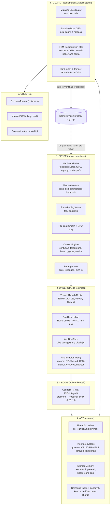

# CoreFlow — Arsitektur & Konteks Tunggal (v6.1.0-R)

Dokumen ini satu-satunya "peta" cara CoreFlow berpikir dan bekerja. Isinya dibagi menjadi tiga bagian: **yang sudah ada** (diverifikasi dari kode dan dump perangkat), **prinsip desain**, dan **celah jujur** yang belum selesai.

> Dokumen acuan arsitektur runtime v6.1.0-R. Kontrak kejujuran dan desain UI ada di [DESIGN.md](DESIGN.md). Dokumen lama [ARCHITECTURE.md](ARCHITECTURE.md) menjelaskan kerangka CFAE v4.0.0 (mutation safety).

## 1. Satu kalimat

> CoreFlow adalah **pengendali umpan-balik tertutup**: ia mengukur kondisi fisik dan beban perangkat, memutuskan **berapa banyak daya yang boleh dipakai sekarang** (satu skalar `capacity_scale`), lalu menerjemahkannya ke batas-batas kernel yang aman, bisa di-rollback, dan tidak melawan OEM.

Tidak ada profil, mode manual, atau per-app preset. Perilaku muncul dari fisika dan telemetri.

## 2. Pipeline 6 lapis



Lokasi kode:

| Lapis | File utama |
|---|---|
| Sense | `src/v5/hardware_probe.cpp`, `src/kernel/thermal_monitor.cpp`, `src/v6/frame_pacing_sensor.cpp`, `src/v5/context_engine.cpp` |
| Understand | `rust/src/thermal_trend.rs`, `rust/src/thermal_model.rs`, `src/kernel/neural_predictor.cpp`, `src/v6/app_dna_store.cpp`, `rust/src/orchestrator.rs` |
| Decide | `rust/src/controller.rs` |
| Act | `src/v5/thread_scheduler.cpp`, `src/v5/thermal_envelope_actuator.cpp`, `src/v5/storage_memory_actuator.cpp`, `src/v6/semantic_knob_engine.cpp` |
| Guard | `src/kernel/mutation_coordinator.cpp`, `src/kernel/baseline_store.cpp`, `src/v6/oem_collaboration_map.cpp`, `src/v6/boot_calm_sanctuary.cpp` |
| Loop | `src/daemon/main.cpp` (reactor + timerfd), `src/daemon/reactor.cpp` |

## 3. Fisika di balik keputusan

1. **Daya dinamis:** \(P \approx C\,V^2 f\). Tegangan naik hampir linear dengan frekuensi di ujung atas OPP, jadi 10% frekuensi terakhir bisa memakan ±25–30% daya tetapi memberi <10% kinerja. Memangkas **lutut atas** itu hampir gratis untuk pengguna dan mengurangi panas secara nyata. Ini alasan `uclamp.max` memotong ceiling dan tidak membekukan frekuensi minimum.
2. **Termal itu RC:** \(T_{chassis} \approx T_{amb} + P_{sustained}\cdot R_\theta\), dengan konstanta waktu menit, bukan detik. Konsekuensinya:
   - Die melonjak cepat (detik), baterai/casing lambat (menit).
   - Keputusan termal harus memakai sinyal lambat (EWMA τ=15 s), bukan suhu die mentah.
   - **Suhu casing tidak bisa dipaksa turun di bawah apa yang dibolehkan daya rata-rata.** Target "38 °C" hanya mungkin jika daya rata-rata jangka panjang cukup kecil. Karena itu target 38 °C bukan satu tombol, melainkan hasil dari anggaran daya.
3. **Responsif = latensi, bukan frekuensi puncak:** Yang menentukan rasa mulus adalah seberapa cepat thread kritis (UI/Render) mendapat kapasitas. Karena itu boost dilakukan **per-TID** (`SYS_sched_setattr`), bukan menaikkan seluruh cluster.
4. **Little's Law (\(L=\lambda W\))** dipakai Orchestrator untuk menentukan siapa bottleneck (CPU, GPU, atau memori/IO) sehingga daya diberikan ke yang membuat pipeline macet, bukan ke semuanya.

## 4. Variabel kendali tunggal

```
sinyal beban + tekanan termal ──► Controller ──► capacity_scale ∈ [0.25, 1.0]
```

`capacity_scale` adalah satu-satunya angka "berapa daya yang boleh". Semua aktuator **menerjemahkan** skalar itu sesuai sifat fisiknya sendiri:

| Aktuator | Terjemahan dari `capacity_scale` |
|---|---|
| ThermalEnvelope | ceiling frekuensi CPU/GPU, `hispeed_load`; `top-app` / `foreground` / `system-background` `cpu.uclamp.max` |
| StorageMemory | `background/cpu.uclamp.max` ke kapasitas core Little saat hangat; readahead |
| ThreadScheduler | uclamp min/max per-TID, dibatasi skalar |
| Knob semantik | agresivitas sched/vm |

Aturan prioritas (urutan menang bila konflik):

1. **Keselamatan keras:** baterai ≥ 58 °C atau die ≥ 95 °C → semuanya rollback ke baseline.
2. **Latensi pengguna:** `LaunchBurst`, jank ≥ 3%, atau suhu dingin → cap `top-app` langsung diangkat.
3. **Termal:** saat hangat → cap daya sesuai skalar.
4. **Baterai:** Low-Battery Eco (≤ 20%) memangkas sedikit tanpa merusak scroll.
5. **Efisiensi idle:** mode `Efficiency` / `ScreenOff` melepas boost, mempertahankan cap EAS.

## 5. Konteks (pengganti "profil")

`ContextEngine` hanya **mengklasifikasi situasi**, tidak memilih preset: `ScreenOff`, `Efficiency`, `Interactive`, `LaunchBurst`, `Gaming` (+ flag kamera/media). Kesimpulannya:

- "Profil" lama (smooth, balanced, gaming, battery, per-app) sudah dilebur. Yang tersisa adalah **konteks terukur + skalar fisik**.
- Kepribadian per-app datang dari **App DNA** (bias terpelajar), bukan dari pengaturan manual.
- Perpindahan konteks berbasis sentuhan (tahan 750 ms di 60 Hz) memang cepat berganti. Itu disengaja agar responsif.

## 6. Invarian yang tidak boleh dilanggar

1. **Satu jalur tulis.** Semua penulisan node lewat `MutationCoordinator` → `BaselineStore` (CFJ4) dengan readback. Tidak ada tulis liar.
2. **Selalu bisa kembali.** Nilai pabrik disimpan sebelum tulis pertama; "release-on-calm" mengembalikan saat tenang.
3. **Satu pemilik per node.** Dua aktuator tidak boleh menulis node yang sama. Di v6.1.0-R, node cap `top-app`, `foreground`, `system-background`, `background` dipaksa berbeda (lihat commit `62cf513`).
4. **Yield ke OEM.** Jika OEM menulis balik node yang sama, CoreFlow mundur dan mencatatnya (`oemYieldedPaths`), dan tidak berperang.
5. **Penemuan dinamis.** Tidak ada path vendor yang di-hardcode; path ditemukan dari mountinfo/sysfs. Satu-satunya konvensi tetap adalah nama grup AOSP kanonik (`top-app`, `foreground`, `background`).
6. **Jujur tentang yang tidak diketahui.** Fitur yang tidak ada di perangkat itu *absen*, tidak ditampilkan sebagai nonaktif. Status tidak boleh melaporkan sesuatu yang tidak diukur (contoh: `autonomousRegime=thermal_pacing` hanya jika baterai ≥ 38,5 °C atau skala < 0,88).

## 7. Cara membaca perilaku di perangkat

| Pertanyaan | Lihat di dump |
|---|---|
| Apakah CoreFlow sedang menekan? | `capacityScale` < 0,90, `autonomousRegime`, `easCappedGroups`, `easTopAppCapPct` |
| Apa yang sebenarnya ditulis? | `journal.entries` (path, nilai pabrik, nilai aktif) |
| Apakah OEM melawan? | `oemYieldedPaths`, `contendedPaths` |
| Seberapa cepat memanas? | `thermalVelocityCpm` (sudah di-EWMA) |
| Berapa daya yang berkelanjutan untuk 38 °C? | `thermalModel` (`valid`, `rThetaCPerW`, `tauSec`, `sustainablePowerMw`, `headroomMw`, `confidence`) |
| Mengapa mode berganti? | `episodes` (ModeShift, LaunchBurst, ThermalRecovered) |
| Apakah ada gangguan? | Self-Audit 6 cek, AVC denials |

## 8. Celah jujur (belum selesai / belum terbukti)

1. **Target 38 °C belum terbukti di perangkat.** Dump terakhir berumur 427 detik pasca-boot (fase panas boot). Butuh dump setelah 20–30 menit pemakaian.
2. **Cap `top-app` tidak berlaku di dump terakhir.** Penyebab yang paling mungkin adalah salah resolusi grup (sudah diperbaiki di `62cf513`), tetapi ini belum dikonfirmasi di perangkat.
3. **Node `background` kemungkinan diperebutkan OEM.** Belum diketahui apakah ini artefak bug yang sama atau OEM sungguhan.
4. **Model termal per-perangkat sudah ada tetapi baru observe-only.** `rust/src/thermal_model.rs` mengidentifikasi \(R_\theta\), \(\tau\), dan suhu ambient secara online (RLS, langkah 10 detik, hanya saat discharging) dan melaporkan `thermalModel.sustainablePowerMw` untuk target 38 °C. Estimator menolak melapor (`valid=false`) tanpa eksitasi daya dan rentang suhu yang cukup. Ia **belum menggerakkan aktuator** sampai dump perangkat memvalidasi angkanya.
5. **Tidak ada ukuran "mulus" end-to-end.** Jank dan fps hanya terukur saat sensor frame aktif; belum ada metrik tunggal (mis. persentil-99 frame time) yang menjadi tujuan optimasi resmi.

## 9. Arah penyempurnaan (urutan usulan)

1. Validasi di perangkat: dump 30 menit, konfirmasi cap `top-app` dan `background`, lalu merge PR #50.
2. Validasi `thermalModel` dari dump (apakah `valid`, apakah \(R_\theta\), \(\tau\), dan `sustainablePowerMw` masuk akal), lalu jadikan `P_budget` input Controller.
3. Satu metrik mulus (p99 frame time + jank) sebagai fungsi tujuan; kendali bisa melonggarkan cap bila mulus sudah terjamin dan mengetatkan bila ada ruang.

