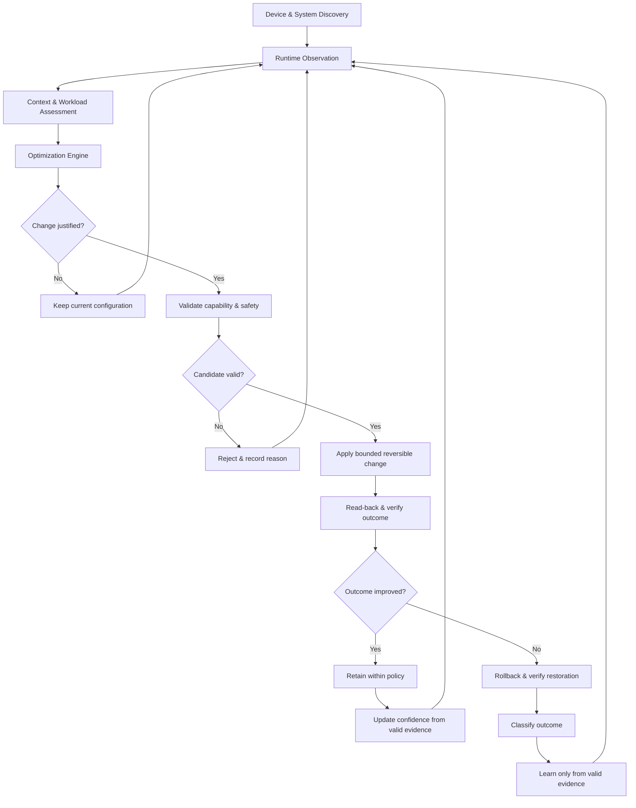

# CoreFlow Autonomous Architecture Contract

**Release line:** `v3.0.0`

**Implementation:** C++20 native Android daemon

**Primary goal:** adaptive system configuration that improves stability, responsiveness and efficiency, with selective performance optimization when the evidence supports it.

This document defines CoreFlow's own engineering contract. Encore Tweaks is a comparison source for implementation ideas and user experience, not the architectural authority for CoreFlow. No Encore implementation code is copied by this release patch; ideas are evaluated against CoreFlow's current interfaces, tests and safety requirements.

## 1. Closed-loop flow

The runtime must never equate “write succeeded” with “optimization succeeded.” Candidate selection, mutation, read-back, measured outcome and learning are distinct stages with explicit outcomes.

## 2. Module boundaries and data contracts

### Device & System Discovery

Discovery enumerates controls actually exposed by the running device. A discovered path is evidence of existence, not permission to mutate it. Capability records should retain resource identity, semantic domain/attribute, current value, advertised choices or trustworthy bounds, observed permissions and optimization eligibility.

Unknown or weakly classified resources can remain observable while staying mutation-ineligible. Add support through a semantic adapter and regression tests rather than inferring meaning from a path name or numeric range alone.

### Runtime Observation

Observations are snapshots with explicit validity. Missing, stale, malformed or non-finite measurements are unknown—not zero and not proof of an idle system. Samples used for deltas or adaptive baselines must be serialized so a later observation cannot be applied before an earlier one.

Signal units must stay separate. PSI percentages, CPU busy ratios and memory-available ratios have different semantics; each uses its own baseline and must not be merged by directly comparing raw units. A fallback can replace an unavailable source only when it measures a relevant and documented aspect of the same decision.

### Context & Workload Assessment

Workload scoring is relative to a device's observed behavior, not a one-size-fits-all preset. A baseline is ready only when it has enough valid evidence. Before readiness, the engine must fail closed for mutation decisions without claiming the device is idle. Sustained high load must not silently become the normal baseline merely because the rolling history drifts.

### Optimization Engine

The optimizer proposes candidates; it does not write kernel resources. A candidate needs a live capability identity, old and proposed values, domain semantics, bounds/choice validation, workload context and a reason that can be inspected in the journal. Search budgets and memory use may be bounded, but the engine must not use arbitrary resource-count caps to pretend the device has fewer controls than discovery actually found.

### Validation & Mutation

Immediately before a write, re-check capability identity and current value, reject no-op or out-of-bound values, and validate the control's semantics. Use one mutation path for writes and restoration. A write must be read back; a changed file identity, symlink substitution, failed read-back or changed capability invalidates the operation. Keep original values and restoration state under RAII so exceptions do not bypass recovery bookkeeping.

### Outcome Verification

Compare only measurements valid and comparable before and after the change. Account for the observation/settling window and the device's own measured noise. An inconclusive result must remain inconclusive; it cannot be converted into a success or used as positive training evidence. Relevant regressions—including thermal headroom regression—can veto retention even when another metric improves.

### Retain, rollback and learning

Retain a mutation only when outcome evidence passes policy. Otherwise attempt rollback and verify restoration. Count a rollback only when restoration is confirmed. Failed or throwing restoration is an unresolved recovery state, must remain visible in status and journal, and must not be reported as successful. Do not allow a later logging or learning exception to falsify the already-measured mutation outcome.

Learning receives the classified outcome, not an unverified boolean supplied by a caller. Do not train on missing or inconclusive evidence. Keep enough decision detail to explain why the candidate was proposed, retained, rejected or rolled back.

## 3. Hard safety invariants vs adaptive policy

Hard invariants are not a universal list of “performance tweaks to disable”; they protect the integrity of the control loop and platform-owned safety mechanisms:

- Do not disable or bypass Android/Linux thermal mitigation, hardware protection, watchdogs, reset/crash controls or other recovery mechanisms.
- Do not mutate protected thermal, battery/charger, regulator, firmware, debug, reset, watchdog or crash surfaces as performance candidates.
- Do not write an unknown control until its semantics, accepted values, identity checks and recovery behavior are understood.
- Do not bypass SELinux, require permissive mode, or ship broad write grants to `/sys` or `/proc` as a shortcut.
- Do not invent observations, substitute a missing value with zero, or call an unverified rollback successful.
- Do not claim global performance, stability, temperature or battery improvements without device-level evidence.

Within these invariants, the adaptive policy should remain extensible. New domains and device adapters can be added without changing the core flow, and candidate breadth should grow through semantic coverage and tests—not by copying static tuning tables wholesale.

## 4. Desktop/landscape-independent operator surface

The release WebUI intentionally supports phone portrait layout only. Landscape and wide viewports show an orientation notice. The page remains self-contained and uses the root manager's WebUI bridge; it must not start a network listener or allow arbitrary shell input. Only fixed, validated command tokens may reach the daemon. Command publication is atomic, and daemon-side validation remains authoritative.

## 5. Reference sources and how to use them

These sources inform design decisions; they do not override the contract above:

- **Encore Tweaks repository:** <https://github.com/Rem01Gaming/encore> — compare native daemon lifecycle, telemetry, configuration, compatibility and UI patterns. Review the exact revision and license before adapting code. This release patch does not import Encore source files.
- **Linux CPUFreq documentation:** <https://docs.kernel.org/admin-guide/pm/cpufreq.html> — learn the distinction between policy, governor, driver and device-specific behavior before proposing CPU-frequency controls.
- **Linux Pressure Stall Information (PSI):** <https://docs.kernel.org/accounting/psi.html> — interpret CPU/memory/I/O contention as stall time, not as a generic utilization score.
- **Android thermal mitigation:** <https://source.android.com/docs/core/power/thermal-mitigation> — preserve platform thermal mitigation and treat thermal severity as a system constraint.
- **Android kernel code and GKI interface guidance:** <https://source.android.com/docs/core/architecture/kernel/kernel-code> — do not assume `sysfs` or debug interfaces are uniform across devices; respect their documented ownership and access model.

If code is adapted from an external project, record the upstream repository, exact commit or release, license, copyright notices and local modifications. Prefer independent implementation when only a design pattern is needed.

## 6. Release acceptance checklist

A release is not complete until the following are checked:

1. Host C++20 configure/build succeeds and all CTest tests execute with assertions enabled.
2. ASan/UBSan and, where supported, TSan runs cover the relevant code paths.
3. Android NDK `arm64-v8a` build passes ELF checks and module packaging.
4. WebUI/shell syntax checks pass; the portrait view, landscape notice, bridge failures and stale status are manually checked.
5. On-device tests verify daemon startup/restart, permissions, SELinux behavior, telemetry validity, pause/resume, mutation read-back, rollback and WebUI command delivery.
6. Performance and energy claims are backed by repeated measurements on the target device and workload, including thermal behavior and regression cases.

Host tests and a successful package build are necessary but do not prove that every kernel control is writable, safe or beneficial on a physical device.
